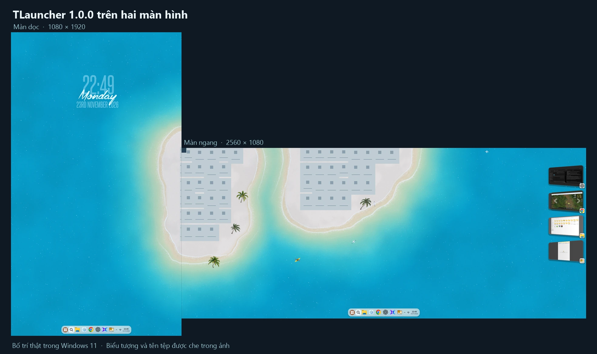
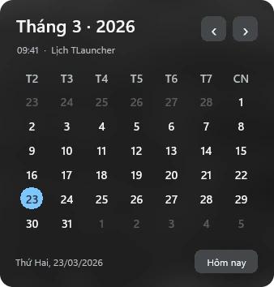

<p align="center">
  <picture>
    <source media="(prefers-color-scheme: dark)" srcset="assets/branding/logo-dark.png">
    <source media="(prefers-color-scheme: light)" srcset="assets/branding/logo-light.png">
    
  </picture>
</p>

<p align="center"><strong>Your Windows. Your Workspace.</strong></p>

[Tiếng Việt](README.md) · **English** · [简体中文](README.zh-CN.md)

# TLauncher — Modern Desktop Workspace for Windows 11

TLauncher is a native Rust desktop workspace for Windows 11, combining a macOS-inspired Dock, Stage Manager, Spotlight search, interactive live wallpapers, and advanced multi-monitor customization in one integrated application.

[](https://github.com/tuanngbc/TLauncher/releases/latest) [](https://github.com/tuanngbc/TLauncher/releases/latest) [](README-rust.md) [](LICENSE) [](https://github.com/tuanngbc/TLauncher/releases) [](https://github.com/tuanngbc/TLauncher/stargazers)

**[Download the latest release for Windows 11 x64](https://github.com/tuanngbc/TLauncher/releases/latest)** · [Changelog](CHANGELOG.md) · [Report an issue](https://github.com/tuanngbc/TLauncher/issues) · [Source code](https://github.com/tuanngbc/TLauncher)

## TLauncher in action



*Real Windows 11 capture. The screens retain their relative scale and placement, and each has its own Dock. Clusters of desktop icons still shape the islands. The Stage cards are visible; desktop icons and filenames have been masked. Some screenshots are from native test builds and show Vietnamese UI labels.*

## Contents

- [TLauncher in action](#tlauncher-in-action)
- [What is TLauncher](#what-is-tlauncher)
- [Features at a glance](#features-at-a-glance)
- [Features and screenshots](#features-and-screenshots)
- [System requirements](#system-requirements)
- [Install and upgrade](#install-and-upgrade)
- [Keyboard shortcuts](#keyboard-shortcuts)
- [Performance and resource use](#performance-and-resource-use)
- [Architecture and technologies](#architecture-and-technologies)
- [Privacy and security](#privacy-and-security)
- [FAQ](#faq)
- [Build from source](#build-from-source)
- [Feedback and contributions](#feedback-and-contributions)
- [Credits and upstream projects](#credits-and-upstream-projects)
- [License](#license)

## What is TLauncher

Pin and open apps with the Dock, organize windows with Stage Manager, find apps and files with Spotlight, and customize each display. The wallpaper, Dock, and Stage Manager can be turned on or off independently. TLauncher is a Windows desktop app and is unrelated to the Minecraft launcher of the same name.

## Features at a glance

| Area | Available in the public release |
| --- | --- |
| Window management | Dock, Stage Manager, Start, Spotlight, and Windows taskbar compatibility mode |
| Desktop | **16** interactive live themes, time-based lighting, weather by location, three display modes, and two clocks |
| Utilities | Control Center, monthly calendar, CPU/GPU/RAM/network indicators, screenshot editor, and MP4 screen recording |
| Personalization | Integrated Settings, per-display layouts, custom shortcuts, and launch at sign-in |

**Version 1.0.1:** When startup is enabled, Windows starts TLauncher at sign-in through Task Scheduler. Dock and Stage Manager initialize before the wallpaper. If Explorer is still starting, the wallpaper tries to attach again. See the [verification notes and test conditions](CHANGELOG.md#kiểm-chứng).

**1.0.2 candidate — Unified Spotlight:** Quick search and an app library share the same TLauncher catalog. Use Alt+Space for Compact, F6 to switch modes, or the Dock magnifier for the fullscreen library. Add EXE/LNK entries, pin, hide or restore apps, and organize them into folders. Windows controls Desktop Acrylic, with a solid theme fallback in the candidate. See the [UAT guide](docs/unified-spotlight.md). The public release is still 1.0.1.

<!-- product-guide:start -->
## Features and screenshots

### Interactive live wallpapers

Choose from **16 themes**, from Beach, Meadow, and Aquarium to Stadium, Ocean, and Summer Veranda. Many scenes arrange elements around groups of desktop icons. Depending on the scene, clicks on empty space create ripples, attract fish, or add clouds; clicking an icon still opens the app. Choose a scene, adjust its settings, or create a layout under **Settings → Wallpaper**.

| Beach | Maldives | Meadow |
| --- | --- | --- |
|  |  |  |

*Previews from three included themes.*

### Weather lighting and solar shadows

Choose offline simulation or **Live weather by location** under **Settings → Weather & Lighting**. Search for a city or postal code to get cloud cover, rain, snow, and wind from Open-Meteo. You can also select clear, cloudy, rainy, stormy, or snowy conditions manually.

With **Time-based lighting** on, TLauncher calculates the sun’s position from the time and chosen coordinates. If no location is set, it uses the local system time. In scenes with tree shadows, such as Beach, the shadows change length and direction as the sun moves. Weather effects and time effects have separate switches.


*A sample city and a diagram showing shadow direction at different times of day.*

### Panoramas and multiple displays

Use **Synchronized** for the same theme on all displays, **Independent** to pick different scenes, or **Panorama** to span the scene using Windows display coordinates. Landscape and portrait layouts and mixed DPI scaling are supported. Pause wallpaper on individual screens, and choose the display, edge, size, and reserved space for the Dock or Stage Manager.


*Example monitors at 100% and 125% scaling.*

### Two desktop clocks

The native clock shows the time, weekday, and date behind your windows. Unlock the clock to drag it, then lock it to pass clicks through. Customize its size, opacity, and individual lines. Add a second clock with its own size and position in **Settings → Clock**.


*The second clock is enabled on the example portrait screen.*

### macOS-inspired Dock

Pin apps, shortcuts, or commands with arguments. Open and switch windows from their icons. Customize icons, hover magnification, size, spacing, frosted glass, and light, dark, or system colors. The Dock can float, reserve work area, or hide when a window is maximized and return when you move the pointer to the edge. Set these options independently for each screen.


*Native test capture with a sample profile.*

### Stage Manager and window groups

Preview windows on perspective or flat cards on the left or right. The active card stands out. Use the two arrows to browse windows in a group. Configure the cards per page, card size, and gaps to the screen edge and work area. Version 1.0.0 smooths diagonal edges even during hover magnification. It was tested at **100%, 125%, and 150%** DPI scaling. Windows may prevent previews of protected windows.


*Native test capture with sample windows.*


### Start and Spotlight

**Start** focuses the search box as it opens and shows pinned, recent, and frequently used apps, along with account and power options. In Dock mode, pressing the **Windows** key on its own can open TLauncher Start. **Spotlight** is a separate search box centered on the screen; open it with the magnifying glass or **Alt+Space**. Search for apps and indexed files, use the arrow keys to select a result, and press Enter to open it.

| Start | Spotlight |
| --- | --- |
|  |  |

*Start from 1.0.0 testing; Spotlight from a native trial build before the product was renamed.*

### Control Center calendar and resource indicators

Open Control Center from the arrow on the Dock to adjust volume or access network and Bluetooth controls. Click the clock to open the calendar and browse months. The Dock can display CPU, GPU, and RAM usage and upload and download speeds. Resource readings and network/volume buttons have separate switches. Use **Windows compatibility** mode for full access to third-party tray icons.

| Monthly calendar | Dock indicators |
| --- | --- |
|  |  |

*The calendar is from 1.0.0 testing; the indicators are from a Dock test capture and do not represent benchmark results.*

### Screenshots and screen recording

Capture a selected region or the entire screen under the pointer. The editor supports cropping, arrows, text, step numbers, pixelation, and solid redaction. Copy to the clipboard or save as PNG/JPG. Record a region to MP4 (H.264) at **30 FPS** by default or **60 FPS**, with optional system audio. You can pause and resume. This release does not record a microphone or webcam and has no dedicated game capture mode.


*Settings before starting a recording.*

### Settings and taskbar modes

One window groups Wallpaper, Displays, Weather & Lighting, Clock, Dock & Stage Manager, Shortcuts & Utilities, and System. The WebView2 Settings interface supports Tiếng Việt, English, and 简体中文; some native surfaces use separate UI strings. Explorer keeps running. Select **Windows compatibility** to use the original Start menu, taskbar, and tray.


*Version 1.0.0 Settings with a sample configuration.*
<!-- product-guide:end -->

## System requirements

- **Windows 11 x64** is the target for the public package; Windows 10 support is not guaranteed.
- An **OpenGL 3.3** driver for native wallpaper rendering. The direct GPU presentation path depends on the driver; GDI is the fallback.
- **Microsoft Edge WebView2 Runtime** for full Settings. If the runtime or `prototype/` is unavailable, basic Win32 settings are available.

## Install and upgrade

1. Open the [latest release](https://github.com/tuanngbc/TLauncher/releases/latest). Under **Assets**, download **TLauncher-…-win-x64.zip** and check it against the corresponding `.zip.sha256` file. **Source code** is for inspection or building locally.
2. Extract the full archive into one folder and run `TLauncher.exe`. Keep `prototype/` for Settings, shaders, and previews, and `assets/widget/` for the clocks. Open Settings from the Dock or system tray.
3. To upgrade, exit the old version and back up your installation folder and `%USERPROFILE%\.deskland-rs`. Keep this profile to retain themes, layouts, pins, and shortcuts.
4. Turn automatic launch on or off under **Settings → System → Start with Windows**. If you move the executable, toggle the setting off and back on to register its new location. See [how to roll back to 1.0.0](CHANGELOG.md#nâng-cấp-và-quay-lại).

## Keyboard shortcuts

| Default | Action |
| --- | --- |
| **Ctrl+Shift+S** | Capture a region; press Space to select the full screen under the pointer. |
| **Ctrl+Shift+R** | Select a recording area; press again to stop and save. |
| **Ctrl+Shift+P** | Pause or resume recording. |
| **Alt+Space** | Open Spotlight. |
| **Ctrl+Alt+L** | Lock the session through Windows. |
| **Ctrl+Alt+Shift+F12** | Restore the Windows taskbar for the current session. |

Change the Spotlight, capture, recording, and lock shortcuts in **Settings → Shortcuts & Utilities**.

## Performance and resource use

Wallpapers usually run at about **30 FPS** and may render faster briefly during interaction. An occluded wallpaper stops receiving new frames. If all wallpapers are covered or the session is locked, rendering pauses. WebView2 is used when Settings is open; capture and recording run on demand.

**Sample observation from v1.0.0:** Windows 11, Ryzen 5 4600G, GTX 1070, **2560×1080 + 1080×1920** displays, Beach in Panorama mode. Over **25.5 seconds / 18 samples**, logs showed **one occluded wallpaper**; the other ran at about **30 FPS**.

| Metric | Observation |
| --- | ---: |
| Main-process CPU, normalized across 12 logical threads | **0.54%** average |
| Private memory (private bytes) | **279 MiB** |
| Resident memory (working set) | **174–176 MiB** |
| TLauncher GPU 3D on the active engine | **1–2%** |
| DWM GPU 3D on the same engine | **0–1%** |


*GPU readings are per process and engine, rather than total GPU use. This snapshot is not a controlled comparison or a guarantee for two visible wallpapers, open Settings, or active recording.*


## Architecture and technologies

- **Rust and Win32** manage the desktop, windows, per-display DPI, and native utilities.
- **OpenGL 3.3 via WGL** renders the wallpaper. On supported systems, **Direct3D 11 and DirectComposition** present GPU frames; **GDI** is the fallback.
- **WebView2** provides full Settings on demand; a basic Win32 interface is also available.
- **Windows Graphics Capture** is used on supported capture paths; **Media Foundation** encodes MP4/H.264.
- **Windows Task Scheduler** registers per-user startup from 1.0.1 onward. See [the Rust guide](README-rust.md) and [architecture docs](docs/README.md).

## Privacy and security

Searching for a place sends a query to Open-Meteo’s geocoding service. Live weather sends the selected place’s coordinates to request the forecast; TLauncher does not retrieve the device’s location for this feature. Offline simulation is available. By default, screenshots and recordings are saved locally in `Pictures/TLauncher` and `Videos/TLauncher`. The user controls when an image is copied to the clipboard.

TLauncher uses Windows session lock and sign-in. The 1.0.1 startup task runs under the current account and does not need administrator rights.

## FAQ

**Why do I only see basic Settings?** Check for the WebView2 Runtime and the `prototype/` folder beside the EXE. Extract the full package if you previously copied only the executable.

**How do I get the Windows taskbar back?** Select **Windows compatibility**, or press **Ctrl+Alt+Shift+F12** to restore it for the current session. Explorer continues running while the Dock is active.

**Why isn’t TLauncher listed in Windows Startup apps?** Version 1.0.1 uses Task Scheduler. Use the switch in TLauncher Settings. If you moved the EXE, toggle the switch off and back on.

**Why can’t I preview or record some windows?** Windows may restrict protected content. Recording supports system audio. This release does not capture microphone audio or a webcam.

**Where is my profile stored, and how can I roll back?** The profile is in `%USERPROFILE%\.deskland-rs`. Back up the profile and installation folder before upgrading. To return to 1.0.0, disable startup in 1.0.1 before exiting, restore the older package, and re-enable startup in the older version if desired.

## Build from source

On Windows, use stable Rust, the MSVC C++ build tools, and the Windows SDK. From the source directory:

```powershell
cargo test --release
cargo build --release
```

See the [Rust build guide](README-rust.md) for resource layout next to the executable. Release packages record the version in `VERSION.txt` and the source commit in `BUILD-COMMIT.txt`.

## Feedback and contributions

[Report a bug or suggest a feature](https://github.com/tuanngbc/TLauncher/issues) with your TLauncher and Windows versions, display layout if relevant, and steps to reproduce. Remove personal data from screenshots and logs. See the [development notes](AGENTS.md) and the [README translation policy](docs/README.md#quy-ước-readme-đa-ngôn-ngữ).

## Credits and upstream projects

- [BLEZZ0102/Deskland](https://github.com/BLEZZ0102/Deskland) — upstream project and the foundation for live wallpapers.
- [nhhoang188/Deskland-VN](https://github.com/nhhoang188/Deskland-VN) — ported themes and Vietnamese localization.
- [tuanngbc/TLauncher](https://github.com/tuanngbc/TLauncher) — [tuanngbc](https://github.com/tuanngbc) develops and maintains the TLauncher fork, including native Rust rendering, desktop improvements, the multi-monitor system (synchronized, independent, and panoramas based on Windows display coordinates), Dock, Stage Manager, Start, Spotlight, taskbar modes, Control Center, calendar, system monitoring, native clocks, screenshot and recording tools, shortcuts, weather and solar shadows, integrated Settings, and the Windows startup improvements.

See [NOTICE](NOTICE), the [original Deskland-VN notice](third_party/deskland-vn/NOTICE), and the [clock design credits](assets/widget/NOTICE.txt).

## License

TLauncher source code is released under [GNU GPL-3.0](LICENSE). See [third-party notices](THIRD_PARTY_NOTICES.md), [trademarks](TRADEMARKS.md), and the [logo guidelines](assets/branding/BRAND.md). TLauncher is an independent project and is not an official Apple or Microsoft product.
