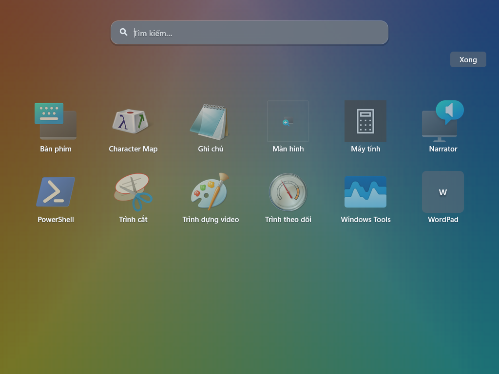
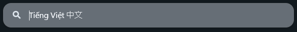
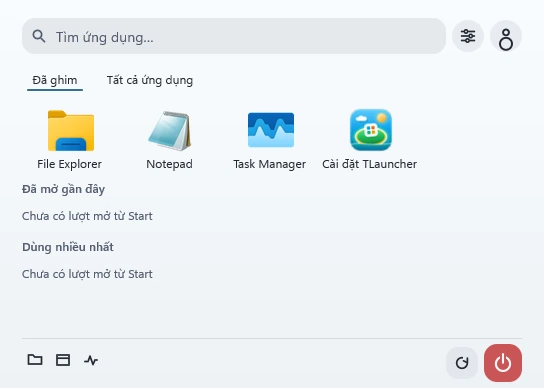
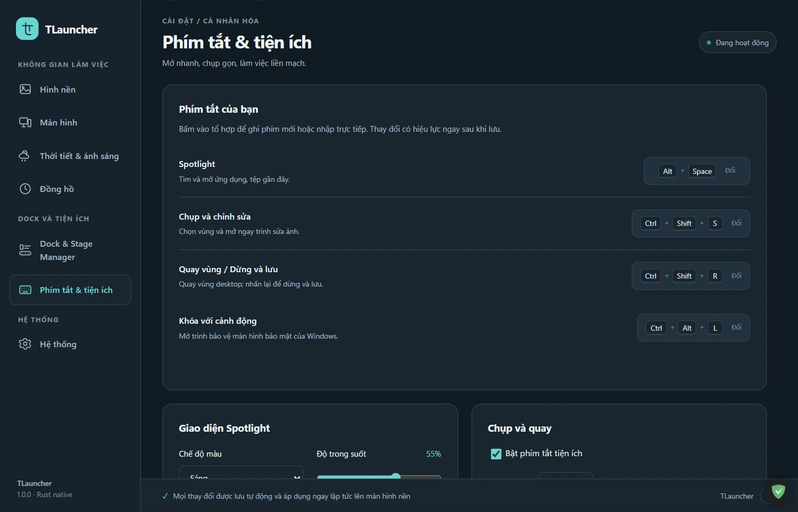

<p align="center">
  <picture>
    <source media="(prefers-color-scheme: dark)" srcset="assets/branding/logo-dark.png">
    
  </picture>
</p>

<p align="center"><strong>Your Windows. Your Workspace.</strong></p>

<p align="center">
  <a href="https://github.com/tuanngbc/TLauncher/releases/latest"></a>
  <a href="https://github.com/tuanngbc/TLauncher/releases/latest"></a>
  <a href="README-rust.md"></a>
  <a href="LICENSE"></a>
  <a href="https://github.com/tuanngbc/TLauncher/releases"></a>
  <a href="https://github.com/tuanngbc/TLauncher/stargazers"></a>
</p>

[Tiếng Việt](README.md) · **English** · [简体中文](README.zh-CN.md)

# Make Windows your own workspace

Maybe you like Windows but wish your desktop were a little calmer, your favorite apps easier to reach, or switching between windows less distracting. **TLauncher** is built around that idea.

TLauncher is a free, open-source desktop workspace for Windows 11, written primarily in native Rust. It brings together a macOS-inspired Dock and Stage Manager, Spotlight, interactive live wallpapers, and everyday utilities without taking away the familiar Windows environment. Use the whole workspace or enable only the pieces you enjoy.

**[⬇ Download TLauncher for Windows 11 x64](https://github.com/tuanngbc/TLauncher/releases/latest)** · [What's new in v1.0.2](docs/releases/v1.0.2.en.md) · [Feedback & issues](https://github.com/tuanngbc/TLauncher/issues)


*An actual Windows 11 desktop from an earlier version, with 2560×1080 landscape and 1080×1920 portrait displays. Personal desktop information has been masked.*

## Explore TLauncher

| Work | Personalize | Everyday tools |
| --- | --- | --- |
| Spotlight, app library, Dock, Stage Manager, Start Menu | 16 live themes, weather, time-based lighting, multiple monitors, two clocks | Control Center, calendar, system indicators, screenshot editing, MP4 recording |

[Spotlight](#spotlight--find-and-launch-without-the-clutter) · [More features](#dock--your-favorite-apps-within-reach) · [Getting started](#get-started-in-a-few-steps) · [Shortcuts](#handy-keyboard-shortcuts) · [FAQ](#frequently-asked-questions)

<!-- product-guide:start -->
## Spotlight — find and launch without the clutter

The centerpiece of **v1.0.2** is Unified Spotlight. Instead of digging through menus to find an app, search instantly with your keyboard or open a full-screen library to browse your discovered applications.


Two ways to use the same search system:

- **Compact Spotlight:** press `Alt + Space` and type an app name, an indexed file, or a system tool. Select a result with the arrow keys and press Enter.
- **Fullscreen Spotlight:** click the magnifying glass on your Dock to open the app library on that display. Scroll or use the keyboard to navigate pages, click an app to launch it, and click empty space or press Esc to dismiss.

Press **F6** to move between modes without losing your query. Prefer full-screen search from the keyboard or Compact from the Dock? Configure each independently, or make the Dock follow the keyboard shortcut, in **Settings → Shortcuts & Utilities → Unified Spotlight**.

### An app library that works the way you do

Spotlight discovers apps from the Start Menu and Windows AppsFolder, filters unsuitable shortcuts, and removes duplicates where identities match. You can then organize the library to suit your workflow.

| A folder in the dark theme | Editing the layout |
| --- | --- |
|  |  |

Right-click an app to rename it, customize its icon, favorite it, pin it to the Dock, or hide it. Use the library's management menu to add an `.exe` or `.lnk`, including portable software, and enter layout editing to rearrange apps and drag them into folders. Restore hidden apps from **Hidden items** in Settings. Hiding or removing a manually added entry never uninstalls or deletes the original program.

### Glass, readable type, and motion at your own pace

Spotlight 1.0.2 has light and dark appearances, a unified rounded search field, ivory labels with subtle shadows, and persistent icon caching that reduces repeated icon loading. Frosted glass uses Windows compositing when supported, with compatibility materials otherwise.

| Light search field | Dark search field |
| --- | --- |
|  |  |

In **Settings → Motion effects**, choose a speed from **0.25× to 2×**; new profiles start at **0.70×**. The shared speed applies to supported transitions in Spotlight, Dock, Start, menus and utility panels. Turn animations off or have TLauncher respect Windows reduced-motion preferences if you prefer.

*The v1.0.2 Spotlight images show real native Windows UI with test data, not mockups. Library screenshots use a fixture backdrop and do not demonstrate live desktop blur. [Image provenance](docs/images/showcase/v1.0.2/README.md).*

## Dock — your favorite apps within reach

Keep the apps you reach for most in one place. Pin apps, shortcuts, or custom commands with arguments; click an icon to launch or switch windows. Icons magnify on hover, the Dock adjusts to its contents, and it can hide to leave more room for maximized windows.


Under **Settings → Dock & Stage Manager**, choose your display, edge, icon size, spacing, magnification, glass and light/dark appearance. Float the Dock above the desktop, reserve work area, or auto-hide it. Each display can have its own arrangement.

## Stage Manager — switch windows without losing your place

When several apps are open, Stage Manager keeps window previews on cards along the edge of the screen. Click a card to switch windows; use the arrows to browse members of a group. Choose flat or perspective cards, their size, how many appear per page, and where they sit.


Windows-protected content may not provide a preview. v1.0.2 retains Windows' standard window minimize/restore behavior; Stage Peek and Genie are not part of this release.

## Start Menu — a familiar way in

Start brings pinned, recent and frequently used apps together with account and power options. Its search field is ready for keyboard input when opened. In Dock mode, pressing the Windows key on its own can open TLauncher's Start; choose **Windows compatibility** if you prefer the original Start menu and taskbar.



## Live wallpapers — bring your desktop to life

Choose from **16 interactive themes**, including Beach, Maldives, Aquarium, Meadow, Stadium, Ocean and Summer Porch. Depending on the scene, clicking empty desktop space can create ripples, attract fish or create clouds; desktop icons remain usable.

| Beach | Maldives | Meadow |
| --- | --- | --- |
|  |  |  |

Open **Settings → Wallpaper** to select a theme and adjust its parameters. Several scenes are arranged around desktop icon clusters. Prefer a static desktop? Disable the wallpaper engine independently and keep Dock, Stage and Spotlight.

### Weather, lighting and shadows that change with the day

Let the scene follow daylight or simulate sun, clouds, rain, snow and wind. Under **Settings → Weather & lighting**, choose manual conditions, offline simulation, or search for a city/postal code to use Open-Meteo data. Scenes with solar shadows adjust their direction and length to the sun's position. Time-based lighting and weather effects can be enabled separately.


## Multiple monitors — more space, more flexibility

Whether you have one display, two landscape monitors or a landscape/portrait combination, choose your wallpaper arrangement in **Settings → Displays**:

| Mode | How it works |
| --- | --- |
| Synchronized | One theme across all displays |
| Independent | A different theme for each display |
| Panorama | One scene spanning the actual Windows display layout |


Pause individual wallpapers and place Dock and Stage separately, including on mixed-DPI layouts.

### Two desktop clocks

Add a clock displaying time, weekday and date below your windows. In **Settings → Clocks**, enable a second clock if desired, choose its display, size, opacity and visible lines. Unlock to drag it into place and lock it again for click-through behavior.


## Everyday utilities, built into your workspace

**Control Center:** open it from the Dock arrow to adjust volume and access network/Bluetooth utilities. Click the date and time to open the monthly calendar. Enable the CPU, GPU, RAM, network and status indicators you need.

| Monthly calendar | System indicators on the Dock |
| --- | --- |
|  |  |

**Screenshots and editing:** press `Ctrl + Shift + S`, drag a region or press Space to select the display under your pointer. Crop, add arrows, text and numbered steps, pixelate or cover sensitive areas, then copy or save as PNG/JPG.

**Screen recording:** press `Ctrl + Shift + R`, select a region, and press it again to stop. Record MP4/H.264 at 30 or 60 FPS, optionally with system playback audio. Pause or resume with `Ctrl + Shift + P`. Microphone, webcam and dedicated game capture modes are not currently included.



## Make it yours

Integrated Settings in Vietnamese, English and Simplified Chinese let you toggle Wallpaper, Dock and Stage independently, configure displays, themes, shortcuts, motion and Windows startup. Some native UI labels may still use a different language. Explorer continues to run; **Windows compatibility** lets you use the original taskbar and system tray, including third-party tray icons.


*Non-Spotlight feature images above come from earlier versions or native test fixtures; layouts and labels may differ slightly in 1.0.2.*
<!-- product-guide:end -->

## Get started in a few steps

**Requirements:** Windows 11 x64, a driver supporting OpenGL 3.3 for live wallpapers, and Microsoft Edge WebView2 Runtime for full Settings. No Rust or developer tools are needed.

1. Download the [Windows x64 package](https://github.com/tuanngbc/TLauncher/releases/latest) under Assets, not Source code. For v1.0.2, the file is `TLauncher-1.0.2-win-x64.zip`; a [SHA-256 checksum](https://github.com/tuanngbc/TLauncher/releases/download/v1.0.2/TLauncher-1.0.2-win-x64.zip.sha256) is available.
2. Extract the **entire package** into a folder you intend to keep. Leave `prototype/`, `assets/widget/` and the other resources beside the EXE.
3. Run `TLauncher.exe` and open Settings from the Dock or system tray. Choose a wallpaper and the components you want, then try Alt+Space.
4. To launch with Windows, enable **Settings → System → Start with Windows**. TLauncher registers a Task Scheduler entry for your account without requiring administrator privileges.

### Recommended settings

| Setting | Recommendation |
| --- | --- |
| Windows transparency | **Settings → Personalization → Colors → Transparency effects: On** |
| Windows animations | **Accessibility → Visual effects → Animation effects: On** if desired |
| TLauncher motion | Enable animations, start at **0.70×**, adjust to taste |
| Spotlight | Compact from Alt+Space; Fullscreen from the Dock, or your own choices |
| Theme | Light, Dark, or Follow system |
| Window transitions | Keep Windows defaults |

These are recommendations, not requirements to run the app. Open the Windows visual effects page via Win+R → `ms-settings:easeofaccess-visualeffects`. If you previously disabled native window animation to test Scale, restore **Animate windows when minimizing and maximizing** via Win+R → `SystemPropertiesPerformance.exe` → Visual Effects.

### Upgrading or rolling back

Exit the old version, back up its installation folder and `%USERPROFILE%\.deskland-rs`, then extract the complete new package. Keep your profile to retain wallpapers, pins, display layout and shortcuts. If the EXE location changes, turn startup off and back on to update Task Scheduler. To return to 1.0.1, disable startup in the new version before exiting, restore the earlier package and appropriate profile backup, then re-enable startup if desired. Older versions may not understand new library data.

## Handy keyboard shortcuts

| Default shortcut | Action |
| --- | --- |
| Alt + Space | Open/dismiss Spotlight |
| F6 | Switch Compact/Fullscreen while Spotlight is open |
| Esc | Leave a folder or dismiss Spotlight |
| ↑ ↓ ← → / Enter | Select and open results |
| Ctrl + Shift + S | Capture a screenshot |
| Ctrl + Shift + R | Start or stop recording |
| Ctrl + Shift + P | Pause or resume recording |
| Ctrl + Alt + L | Lock Windows |
| Ctrl + Alt + Shift + F12 | Restore the Windows taskbar for the current session |

Customize Spotlight, capture, recording and lock shortcuts under **Shortcuts & Utilities**.

## Designed to live alongside your desktop

TLauncher uses Rust and Win32 for desktop integration, OpenGL 3.3/WGL for wallpapers, Direct3D 11/DirectComposition where compatible, and GDI as a fallback. WebView2 provides Settings on demand; Windows Graphics Capture and Media Foundation support compatible capture/recording paths.

Wallpapers normally run around 30 FPS, can briefly increase during interaction, and reduce or suspend rendering work when occluded, locked or the display is off. v1.0.2 focuses on icon reuse, bounded preview caches, shared graphics factories and releasing Spotlight surfaces when closed. The aim is a responsive desktop without unnecessary graphics work.

There is not yet a whole-application benchmark establishing 100–150 MiB RAM, 3% GPU or 1% CPU across configurations. See the [resource optimization report](docs/TLAUNCHER_RESOURCE_OPTIMIZATION_REPORT.md) for measurements and their scope. Actual usage depends on scenes, displays, drivers and active features.

## Frequently asked questions

**Why isn't glass showing up?** Check Transparency effects. Native glass depends on Windows compositing and drivers; TLauncher can use a blurred snapshot or solid material otherwise. High Contrast is respected.

**Why is an app missing from Spotlight?** Some non-app shortcuts are filtered. Add its EXE/LNK manually or check hidden items.

**Why do I only see basic Settings?** Check the WebView2 Runtime and the `prototype/` folder beside the EXE.

**Can I return to the original Windows desktop?** Choose Windows compatibility or Ctrl+Alt+Shift+F12 to restore the taskbar for this session. Choose Exit from the TLauncher menu to quit.

**Why isn't TLauncher listed in Startup apps?** Since 1.0.1, startup is registered through Task Scheduler. Use TLauncher's Settings toggle.

**Are Scale and Genie available?** No. Scale did not pass real-machine acceptance and is hidden in the public release. Windows handles minimize/restore normally. Glass quality, IME behavior and some preview capabilities still depend on the Windows environment.

## Privacy

Live weather sends the selected location query and coordinates to Open-Meteo; it does not automatically obtain your device location for that feature. Offline simulation is available. Screenshots and recordings are saved locally by default in `Pictures/TLauncher` and `Videos/TLauncher`. Windows may block capture of protected content.

## For developers and the community

TLauncher is an independent open-source project, unrelated to the Minecraft launcher of the same name and not an official Apple or Microsoft product.

To build from source, use stable Rust, C++ MSVC tools and the Windows SDK on Windows:

```powershell
cargo test --release
cargo build --release
```

See the [Rust guide](README-rust.md), [technical documentation](docs/README.md), [development notes](AGENTS.md) and [changelog](CHANGELOG.md). Release packages include `VERSION.txt` and `BUILD-COMMIT.txt`.

Have an idea or found a bug? [Open an issue](https://github.com/tuanngbc/TLauncher/issues) with your version, Windows build, display layout and reproduction steps. Please mask private information in screenshots and logs.

## Credits

TLauncher is developed and maintained by [tuanngbc](https://github.com/tuanngbc), building on the live wallpaper foundation of [BLEZZ0102/Deskland](https://github.com/BLEZZ0102/Deskland) and themes and Vietnamese localization from [nhhoang188/Deskland-VN](https://github.com/nhhoang188/Deskland-VN). It extends that foundation with a native Rust renderer, multi-display support, window management, launchers and desktop utilities.

Thank you to the authors and open-source community that made this project possible. See [NOTICE](NOTICE), [Deskland-VN NOTICE](third_party/deskland-vn/NOTICE) and [clock design credits](assets/widget/NOTICE.txt).

**License:** [GNU GPL-3.0](LICENSE) · [Third-party notices](THIRD_PARTY_NOTICES.md) · [Trademarks](TRADEMARKS.md) · [Brand guidelines](assets/branding/BRAND.md).
