<p align="center">
  <picture>
    <source media="(prefers-color-scheme: dark)" srcset="assets/branding/logo-dark.png">
    <source media="(prefers-color-scheme: light)" srcset="assets/branding/logo-light.png">
    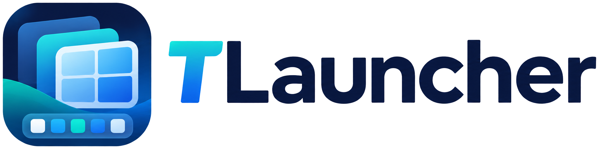
  </picture>
</p>

<p align="center"><strong>Your Windows. Your Workspace.</strong></p>

**Tiếng Việt** · [English](README.en.md) · [简体中文](README.zh-CN.md)

# TLauncher — Không gian làm việc hiện đại cho Windows 11

TLauncher là bộ công cụ quản lý không gian làm việc mã nguồn mở dành cho Windows 11. Ứng dụng viết bằng Rust native, kết hợp Dock lấy cảm hứng từ macOS, Stage Manager, Spotlight, hình nền động tương tác và hệ thống đa màn hình.

[](https://github.com/tuanngbc/TLauncher/releases/latest) [](https://github.com/tuanngbc/TLauncher/releases/latest) [](README-rust.md) [](LICENSE) [](https://github.com/tuanngbc/TLauncher/releases) [](https://github.com/tuanngbc/TLauncher/stargazers)

**[Tải bản mới nhất cho Windows 11 x64](https://github.com/tuanngbc/TLauncher/releases/latest)** · [Nhật ký thay đổi](CHANGELOG.md) · [Báo lỗi](https://github.com/tuanngbc/TLauncher/issues) · [Mã nguồn](https://github.com/tuanngbc/TLauncher)

## Giao diện thực tế

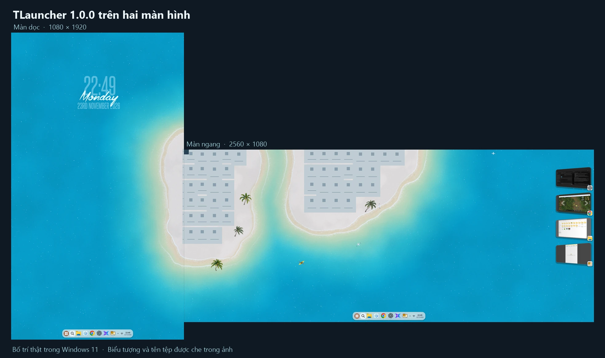

*Ảnh Windows 11 với hai màn ghép đúng tỷ lệ và vị trí. Mỗi màn có Dock riêng. Các cụm icon vẫn tạo hình đảo. Ảnh giữ các thẻ Stage; biểu tượng và tên tệp desktop đã được che. Một số ảnh minh họa chụp từ bản thử native, với nhãn giao diện tiếng Việt.*

## Mục lục

- [Giao diện thực tế](#giao-diện-thực-tế)
- [TLauncher là gì](#tlauncher-là-gì)
- [Tính năng chính](#tính-năng-chính)
- [Chi tiết và ảnh minh họa](#chi-tiết-và-ảnh-minh-họa)
- [Yêu cầu hệ thống](#yêu-cầu-hệ-thống)
- [Cài đặt và nâng cấp](#cài-đặt-và-nâng-cấp)
- [Phím tắt bàn phím](#phím-tắt-bàn-phím)
- [Hiệu năng và tài nguyên](#hiệu-năng-và-tài-nguyên)
- [Kiến trúc và công nghệ](#kiến-trúc-và-công-nghệ)
- [Quyền riêng tư và bảo mật](#quyền-riêng-tư-và-bảo-mật)
- [FAQ](#faq)
- [Build từ mã nguồn](#build-từ-mã-nguồn)
- [Góp ý và đóng góp](#góp-ý-và-đóng-góp)
- [Ghi nhận và dự án gốc](#ghi-nhận-và-dự-án-gốc)
- [Giấy phép](#giấy-phép)

## TLauncher là gì

Ghim và mở app bằng Dock, quản lý cửa sổ bằng Stage Manager, tìm app và tệp bằng Spotlight, rồi tùy biến từng màn hình. Có thể bật hoặc tắt hình nền, Dock và Stage riêng. TLauncher là ứng dụng desktop Windows, không liên quan đến trình khởi chạy Minecraft cùng tên.

## Tính năng chính

| Nhóm | Có trong bản công khai |
| --- | --- |
| Quản lý cửa sổ | Dock, Stage Manager, Start, tìm kiếm Spotlight và chế độ tương thích thanh tác vụ Windows |
| Desktop | **16 chủ đề** động tương tác, ánh sáng theo giờ, thời tiết theo vị trí, ba chế độ đa màn hình và hai đồng hồ |
| Tiện ích | Trung tâm điều khiển, lịch tháng, chỉ số CPU/GPU/RAM/mạng, chụp và sửa ảnh, quay màn hình MP4 |
| Cá nhân hóa | Cài đặt tích hợp, bố trí theo màn hình, phím tắt tùy chỉnh và tự khởi động khi đăng nhập |

**Bản 1.0.1:** Khi bật tự khởi động, Windows mở TLauncher lúc đăng nhập qua Task Scheduler. Dock và Stage khởi tạo trước hình nền; nếu Explorer chưa sẵn sàng, hình nền thử gắn lại sau. Xem [ghi chú và điều kiện kiểm chứng](CHANGELOG.md#kiểm-chứng).

## Có gì mới trong v1.0.2

**Unified Spotlight** kết hợp tìm nhanh và thư viện ứng dụng. Phím **Alt+Space** mặc định mở chế độ thu gọn; kính lúp trên Dock mặc định mở thư viện toàn màn hình trên màn chứa Dock. Hai chế độ mở chỉnh độc lập, hoặc cho Dock dùng theo phím tắt. **F6** đổi chế độ và giữ nội dung tìm; **Esc** quay lại từ thư mục hoặc đóng. Bấm vùng trống để đóng toàn màn hình; cuộn hoặc dùng bàn phím để chuyển trang.

Thư viện phát hiện ứng dụng Win32 từ Start Menu và ứng dụng đóng gói từ Windows AppsFolder. Dùng tìm kiếm cho ứng dụng, tệp đã lập chỉ mục và công cụ hệ thống. Thêm **EXE/LNK**, đổi tên và icon, yêu thích, ghim Dock, ẩn/khôi phục, sắp xếp hoặc kéo vào thư mục trong chế độ chỉnh bố cục. Ẩn hay bỏ mục tự thêm chỉ đổi thư viện, không gỡ ứng dụng. Hướng dẫn mở lần đầu trong Cài đặt với hồ sơ mới và có thể mở lại ở **Phím tắt & tiện ích → Unified Spotlight**.

**Kính và chuyển động.** Toàn màn hình dùng HostBackdrop/Acrylic native khi Windows hỗ trợ; nếu không có thể dùng ảnh nền làm mờ một lần trong bộ nhớ, hoặc nền đặc khi tắt trong suốt/ở High Contrast. Giao diện sáng/tối dùng ô tìm thống nhất, chữ trắng ngà, bóng chữ và khử răng cưa grayscale. Trình nhập native vẫn giữ vùng chọn và xử lý bàn phím của Windows. Cài đặt tốc độ chung **0,25×–2,00×**, bước **0,05×**, mặc định hồ sơ mới **0,70×**; giữ tốc độ đã lưu. Spotlight, Start, menu Dock, Trung tâm điều khiển và lịch dùng chuyển động phù hợp từng bảng; Dock phóng icon, co/mở và tự ẩn. Cài đặt giảm chuyển động của hệ thống được tôn trọng khi bật tùy chọn tương ứng.

**Tài nguyên.** Start, Spotlight và Dock tái sử dụng icon nguồn trong bộ nhớ giới hạn và cache đĩa; chỉ làm mới mục có nguồn thay đổi. Nạp trước có giới hạn, giữ icon tùy chỉnh. Độ nét và thời gian hiển thị lần đầu còn tùy icon nguồn. Spotlight tái sử dụng bộ dựng đồ họa, giải phóng bề mặt khi đóng; cache preview Stage có giới hạn. Chưa có benchmark toàn ứng dụng để xác nhận mốc RAM 100–150 MiB, GPU 3% hay CPU 1%.

**Hiệu ứng cửa sổ:** bản public dùng **Windows Default**. Scale chưa đạt nghiệm thu của owner và được ẩn khỏi bản công khai; Genie và Stage Peek chưa có. Không cần tắt animation Windows. Kính và IME có thể khác theo build Windows, driver và ngôn ngữ nhập.

| Thư viện Spotlight toàn màn hình, chế độ sáng | Thư mục ứng dụng Spotlight ở chế độ tối | Ô tìm Spotlight native có vùng chọn văn bản |
| --- | --- | --- |
|  | 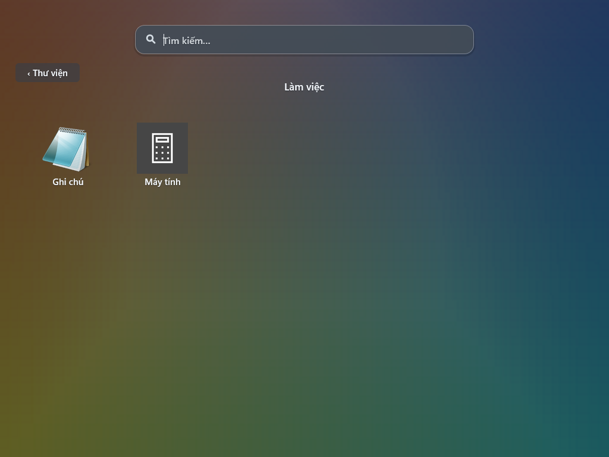 | 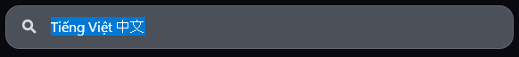 |

*Ảnh giao diện thật từ kiểm thử native Windows trên Actions với ứng dụng mẫu và nền kiểm thử. Xem [nguồn ảnh và giới hạn](docs/images/showcase/v1.0.2/README.md).*

[Ghi chú phát hành](docs/releases/v1.0.2.vi.md)


<!-- product-guide:start -->
## Chi tiết và ảnh minh họa

### Hình nền động và tương tác

Chọn trong **16 chủ đề**, từ Bãi biển, Thảo nguyên và Hồ cá đến Sân vận động, Đại dương và Hiên nhà mùa hè. Nhiều cảnh tạo bố cục quanh các cụm icon desktop. Tùy cảnh, bấm vùng trống tạo gợn nước, gọi cá hoặc tạo cụm mây; bấm icon vẫn mở ứng dụng. Đổi cảnh, chỉnh tham số hoặc tạo bố cục trong **Cài đặt → Hình nền**.

| Bãi biển | Đảo Maldives | Thảo nguyên |
| --- | --- | --- |
|  |  |  |

*Ba ảnh xem trước từ các chủ đề đi kèm.*

### Thời tiết ánh sáng và bóng đổ

Chọn mô phỏng ngoại tuyến hoặc **Theo vị trí thật** trong **Cài đặt → Thời tiết & ánh sáng**. Tìm thành phố hoặc mã bưu chính để lấy mây, mưa, tuyết và gió từ Open-Meteo. Có thể chọn thủ công kiểu trời quang, nhiều mây, mưa, giông hoặc tuyết.

Khi bật **Đổi theo thời gian**, TLauncher tính vị trí Mặt Trời từ giờ và tọa độ đã chọn; nếu chưa chọn vị trí, ứng dụng dùng giờ trên máy. Cảnh hỗ trợ bóng cây như Bãi biển đổi hướng và độ dài bóng theo nắng. Hiệu ứng theo giờ và theo thời tiết có công tắc riêng.

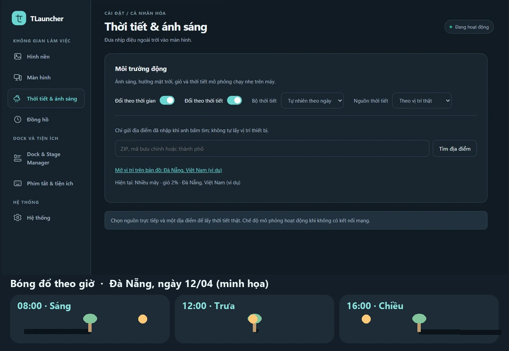

*Giao diện với thành phố mẫu và sơ đồ hướng bóng theo giờ.*

### Toàn cảnh và nhiều màn hình

Dùng **Đồng bộ** để dùng một chủ đề trên mọi màn, **Độc lập** để chọn cảnh riêng, hoặc **Toàn cảnh** để trải cảnh theo tọa độ màn hình của Windows. Hỗ trợ bố trí ngang/dọc và mức thu phóng DPI khác nhau. Có thể tạm dừng nền riêng từng màn và chọn màn, cạnh, kích cỡ và cách giữ chỗ cho Dock hoặc Stage.


*Hai màn hình mẫu dùng mức thu phóng 100% và 125%.*

### Hai đồng hồ desktop

Đồng hồ native hiện giờ, thứ và ngày bên dưới các cửa sổ. Mở khóa để kéo, rồi khóa lại để chuột đi xuyên qua. Chỉnh kích cỡ, độ trong mờ và từng dòng. Có thể bật đồng hồ thứ hai, đặt vị trí và kích cỡ riêng trong **Cài đặt → Đồng hồ**.


*Đồng hồ thứ hai được bật trên màn dọc mẫu.*

### Dock lấy cảm hứng từ macOS

Ghim app, shortcut hoặc lệnh có đối số; mở và chuyển cửa sổ từ icon. Tùy chỉnh icon, độ phóng khi rê chuột, kích cỡ, khoảng cách, kính mờ và màu sáng, tối hoặc theo hệ thống. Dock có thể nổi, giữ vùng làm việc riêng hoặc tự ẩn khi cửa sổ phóng tối đa rồi hiện lại khi rê vào cạnh. Cấu hình có thể khác nhau theo từng màn.


*Ảnh thử nghiệm native với hồ sơ mẫu.*

### Stage Manager và nhóm cửa sổ

Xem trước cửa sổ trên các thẻ phối cảnh hoặc phẳng ở cạnh trái hoặc phải. Thẻ đang hoạt động nổi bật; hai mũi tên cho phép duyệt thành viên trong nhóm. Chỉnh số thẻ mỗi trang, kích cỡ, khoảng cách đến mép và vùng làm việc. Bản 1.0.0 khử răng cưa viền chéo cả khi rê chuột phóng thẻ; kiểm thử bao phủ DPI **100%, 125% và 150%**. Cửa sổ được Windows bảo vệ có thể không cho xem trước.


*Ảnh kiểm thử native với cửa sổ mẫu.*

### Start và Spotlight

**Start** tự đưa bàn phím vào ô tìm kiếm, hiện ứng dụng ghim, gần đây và dùng nhiều, cùng tùy chọn tài khoản và nguồn. Ở chế độ Dock, nhấn riêng phím **Windows** có thể mở Start của TLauncher. **Spotlight** là ô tìm riêng ở giữa màn hình, mở bằng kính lúp hoặc **Alt+Space**. Spotlight tìm ứng dụng và các tệp đã được lập chỉ mục; dùng mũi tên để chọn và Enter để mở.

| Start | Spotlight |
| --- | --- |
| 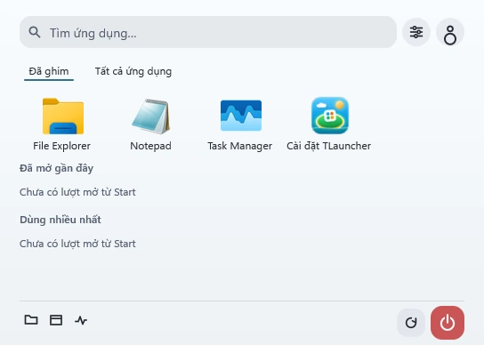 | 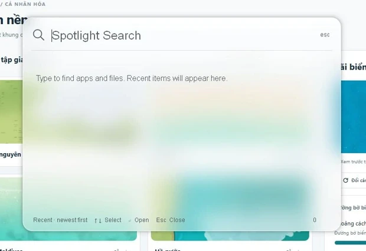 |

*Start từ kiểm thử 1.0.0; Spotlight từ bản thử native trước khi đổi tên sản phẩm.*

### Trung tâm điều khiển lịch và tài nguyên

Mở Trung tâm điều khiển từ mũi tên trên Dock để chỉnh âm lượng và truy cập tiện ích mạng/Bluetooth. Bấm ngày giờ để mở lịch và chuyển tháng. Dock hiện CPU, GPU, RAM và tốc độ tải lên/xuống; có công tắc riêng cho các chỉ số và cụm mạng/âm lượng. Dùng **Tương thích Windows** để thao tác đầy đủ với khay của ứng dụng bên thứ ba.

| Lịch tháng | Chỉ số trên Dock |
| --- | --- |
| 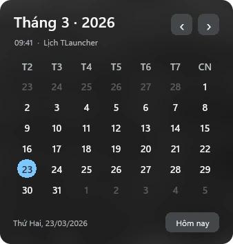 | 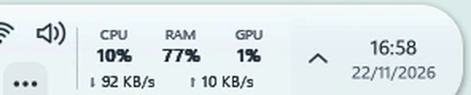 |

*Lịch từ kiểm thử 1.0.0; vùng chỉ số từ một ảnh thử Dock, không phải số liệu benchmark.*

### Chụp ảnh và quay màn hình

Chụp vùng kéo chọn hoặc cả màn hình dưới con trỏ. Trình sửa có cắt, mũi tên, chữ, số bước, che kiểu pixel và tô kín; sao chép vào clipboard hoặc lưu PNG/JPG. Quay vùng chọn thành MP4 (H.264), **30 FPS** mặc định hoặc **60 FPS**, có hoặc không có tiếng phát từ máy. Có tạm dừng/tiếp tục; bản hiện tại chưa có mic, webcam hay chế độ quay game riêng.

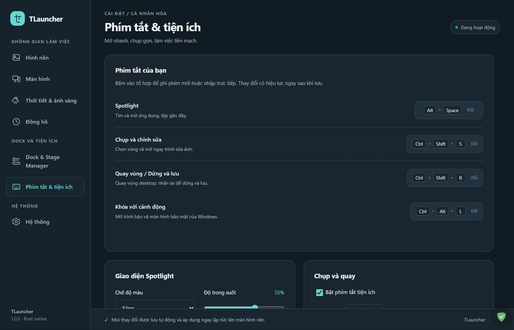

*Giao diện cấu hình trước khi bắt đầu ghi.*

### Cài đặt và chế độ thanh tác vụ

Một cửa sổ nhóm Hình nền, Màn hình, Thời tiết & ánh sáng, Đồng hồ, Dock & Stage Manager, Phím tắt & tiện ích và Hệ thống. WebView2 Settings có Tiếng Việt, English và 简体中文; một số giao diện native có thể dùng văn bản riêng. Explorer vẫn chạy. Chọn **Tương thích Windows** để dùng Start, taskbar và khay gốc.


*Giao diện 1.0.0 với cấu hình mẫu.*
<!-- product-guide:end -->

## Yêu cầu hệ thống

- **Windows 11 x64** là nền tảng của gói công khai; không có cam kết hỗ trợ Windows 10.
- Driver hỗ trợ **OpenGL 3.3** cho hình nền native. Đường hiển thị GPU trực tiếp tùy driver; GDI là đường dự phòng.
- **Microsoft Edge WebView2 Runtime** cho Cài đặt đầy đủ. Nếu Runtime hoặc `prototype/` không khả dụng, TLauncher có Cài đặt Win32 cơ bản.

## Cài đặt và nâng cấp

1. Tải [TLauncher-1.0.2-win-x64.zip](https://github.com/tuanngbc/TLauncher/releases/download/v1.0.2/TLauncher-1.0.2-win-x64.zip) và đối chiếu [SHA-256](https://github.com/tuanngbc/TLauncher/releases/download/v1.0.2/TLauncher-1.0.2-win-x64.zip.sha256) nếu cần. Mục **Source code** dành cho người đọc mã hoặc tự build.
2. Giải nén cả gói, giữ `prototype/` và `assets/widget/` cạnh EXE. Chạy `TLauncher.exe`; mở Cài đặt từ Dock hoặc khay để chỉnh chế độ Spotlight, giao diện, tốc độ và tự khởi động.
3. Nhấn **Alt+Space**, **F6** để đổi chế độ, **Esc** để đóng. Bấm phải mục trong thư viện để thêm, chỉnh, ghim hoặc ẩn; vào **Chỉnh sửa bố cục** để quản lý thư mục, và **Mục đã ẩn** trong Settings để khôi phục. Chọn **Thoát** trong menu TLauncher để dọn Shell; **Ctrl+Alt+Shift+F12** khôi phục thanh Windows trong phiên hiện tại.
4. **Nâng từ 1.0.1:** Thoát bản cũ và sao lưu thư mục cài đặt cùng `%USERPROFILE%\.deskland-rs`. Giải nén gói mới đầy đủ; giữ hồ sơ để dùng tiếp chủ đề, màn hình, mục ghim và phím tắt. Nếu EXE đổi chỗ, kiểm tra **Cài đặt → Hệ thống → Khởi động cùng Windows**; tắt rồi bật để cập nhật Task Scheduler nếu cần.
5. **Quay lại 1.0.1:** Tắt startup trong bản mới, thoát, khôi phục gói cũ và bản sao hồ sơ trước nâng nếu cần; đăng ký startup lại từ bản cũ. Không giả định bản 1.0.1 hiểu dữ liệu thư viện mới. Không xóa hồ sơ hiện tại khi chưa sao lưu.

### Thiết lập Windows khuyến nghị

- **Kính mờ (tùy chọn):** Windows 11 → **Cài đặt → Cá nhân hóa → Màu sắc → Hiệu ứng trong suốt**. Cũng có tại **Trợ năng → Hiệu ứng hình ảnh** (`ms-settings:easeofaccess-visualeffects`). Chất lượng kính tùy compositor và driver; khi tắt hoặc dùng High Contrast, nền dự phòng là hành vi dự kiến.
- **Chuyển động (tùy chọn):** Bật **Animation effects** tại **Trợ năng → Hiệu ứng hình ảnh** nếu muốn. Giữ hiệu ứng thu/phóng Windows mặc định; nếu từng tắt để thử Scale, mở **Win+R → SystemPropertiesPerformance.exe → Visual Effects**, đánh dấu **Animate windows when minimizing and maximizing** rồi Apply. Giữ làm mượt chữ nếu phù hợp; không cần đổi font hay cài theme macOS.
- **TLauncher:** Bật animation, dùng **0,70×** làm điểm bắt đầu, chọn sáng/tối/theo hệ thống. Đặt Compact bằng phím tắt và Fullscreen bằng Dock hoặc chỉnh theo ý. Giữ chất lượng hình nền phù hợp driver; tự chạy khi đăng nhập là tùy chọn.


## Phím tắt bàn phím

| Mặc định | Tác vụ |
| --- | --- |
| **Ctrl+Shift+S** | Chụp vùng chọn; nhấn Space để chọn cả màn hình dưới con trỏ. |
| **Ctrl+Shift+R** | Chọn vùng quay; nhấn lại để dừng và lưu. |
| **Ctrl+Shift+P** | Tạm dừng hoặc tiếp tục bản quay. |
| **Alt+Space** | Mở Spotlight. |
| **Ctrl+Alt+L** | Khóa phiên qua Windows. |
| **Ctrl+Alt+Shift+F12** | Hiện lại thanh tác vụ Windows trong phiên hiện tại. |

Đổi phím Spotlight, chụp, quay và khóa trong **Cài đặt → Phím tắt & tiện ích**.

## Hiệu năng và tài nguyên

Hình nền thường chạy khoảng **30 FPS** và có thể tăng ngắn khi tương tác. Nền bị che ngừng nhận khung mới; khi tất cả bị che hoặc phiên bị khóa, bộ dựng hình tạm dừng. WebView2 dùng khi mở Cài đặt; chụp và quay chạy theo yêu cầu.

**Mẫu quan sát v1.0.0:** Windows 11, Ryzen 5 4600G, GTX 1070, hai màn **2560×1080 + 1080×1920**, cảnh Bãi biển ở chế độ Toàn cảnh. Trong **25,5 giây / 18 mẫu**, nhật ký ghi nhận **một nền bị che**; nền còn lại chạy khoảng **30 FPS**.

| Chỉ số | Quan sát |
| --- | ---: |
| CPU tiến trình chính, chuẩn hóa theo 12 luồng logic | **0,54%** trung bình |
| RAM riêng (private bytes) | **279 MiB** |
| RAM đang lưu trú (working set) | **174–176 MiB** |
| GPU 3D của TLauncher trên engine hoạt động | **1–2%** |
| GPU 3D của DWM trên cùng engine | **0–1%** |

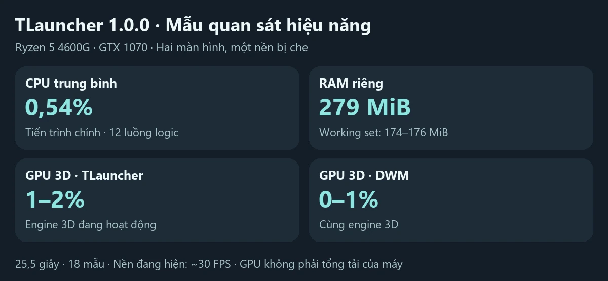

*GPU tính theo tiến trình và engine, không phải GPU tổng. Đây là mẫu quan sát, không phải phép đo đối chứng hay cam kết cho hai nền cùng lộ, lúc mở Cài đặt hoặc đang quay.*

## Kiến trúc và công nghệ

- **Rust + Win32** quản lý desktop, cửa sổ, DPI theo màn hình và tiện ích native.
- **OpenGL 3.3 qua WGL** dựng hình nền. Khi tương thích, **Direct3D 11 / DirectComposition** trình chiếu khung GPU; **GDI** là đường dự phòng.
- **WebView2** hiển thị Cài đặt đầy đủ khi cần; có giao diện Win32 cơ bản.
- **Windows Graphics Capture** dùng cho các đường lấy ảnh có hỗ trợ; **Media Foundation** mã hóa MP4/H.264.
- **Windows Task Scheduler** đăng ký tự mở theo tài khoản từ 1.0.1. Xem [hướng dẫn bản Rust](README-rust.md) và [tài liệu kiến trúc](docs/README.md).

## Quyền riêng tư và bảo mật

Tìm địa điểm gửi truy vấn đến dịch vụ geocoding của Open-Meteo. Khi dùng thời tiết trực tiếp, tọa độ của địa điểm đã chọn được gửi để lấy dự báo; ứng dụng không tự lấy vị trí thiết bị cho tính năng này. Có mô phỏng ngoại tuyến. Ảnh và video mặc định lưu trên máy trong `Pictures/TLauncher` và `Videos/TLauncher`; người dùng chọn khi sao chép ảnh vào clipboard.

TLauncher dùng cơ chế khóa và đăng nhập của Windows. Tác vụ tự khởi động 1.0.1 chạy theo tài khoản hiện tại và không yêu cầu quyền quản trị.

## FAQ

**Vì sao chỉ thấy Cài đặt cơ bản?** Kiểm tra WebView2 Runtime và `prototype/` cạnh EXE. Giải nén cả gói nếu trước đó chỉ lấy EXE.

**Làm sao lấy lại thanh tác vụ Windows?** Chọn **Tương thích Windows** hoặc nhấn **Ctrl+Alt+Shift+F12** để hiện lại trong phiên hiện tại. Explorer vẫn hoạt động khi dùng Dock.

**Vì sao không thấy startup trong trang Ứng dụng khởi động của Windows?** Bản 1.0.1 dùng Task Scheduler. Dùng công tắc trong Cài đặt TLauncher; nếu EXE đã chuyển chỗ, tắt rồi bật lại công tắc.

**Vì sao một số cửa sổ không có ảnh xem trước hoặc không quay được?** Windows có thể hạn chế nội dung được bảo vệ. Quay hỗ trợ tiếng phát từ máy; không có thu mic hoặc webcam trong bản hiện tại.

**Hồ sơ và rollback:** Xem mục Cài đặt và nâng cấp ở trên.

## Build từ mã nguồn

Dùng Rust stable, công cụ C++ MSVC và Windows SDK trên Windows. Trong thư mục mã nguồn:

```powershell
cargo test --release
cargo build --release
```

Xem [hướng dẫn chạy bản Rust](README-rust.md) để bố trí tài nguyên cạnh EXE. Gói Release ghi phiên bản trong `VERSION.txt` và commit trong `BUILD-COMMIT.txt`.

## Góp ý và đóng góp

[Báo lỗi hoặc đề xuất](https://github.com/tuanngbc/TLauncher/issues) kèm phiên bản TLauncher, phiên bản Windows, bố trí màn hình (nếu liên quan) và các bước tái hiện. Che dữ liệu cá nhân trong ảnh/log. Xem [ghi chú phát triển](AGENTS.md) và [quy ước đồng bộ README](docs/README.md#quy-ước-readme-đa-ngôn-ngữ).

## Ghi nhận và dự án gốc

- [BLEZZ0102/Deskland](https://github.com/BLEZZ0102/Deskland) — dự án gốc và nền tảng hình nền động.
- [nhhoang188/Deskland-VN](https://github.com/nhhoang188/Deskland-VN) — các chủ đề được chuyển sang và phần bản địa hóa tiếng Việt.
- [tuanngbc/TLauncher](https://github.com/tuanngbc/TLauncher) — [tuanngbc](https://github.com/tuanngbc) phát triển và duy trì bản fork TLauncher, gồm bộ dựng hình Rust native, cải tiến desktop, hệ thống đa màn hình (đồng bộ, độc lập, toàn cảnh theo tọa độ Windows), Dock, Stage Manager, Start, Spotlight, chế độ thanh tác vụ, Trung tâm điều khiển, lịch, chỉ số hệ thống, đồng hồ native, chụp/quay, phím tắt, thời tiết và bóng đổ theo Mặt Trời, Cài đặt tích hợp và cải tiến khởi động Windows.

Xem [NOTICE](NOTICE), [ghi nhận gốc của Deskland-VN](third_party/deskland-vn/NOTICE) và [nguồn thiết kế đồng hồ](assets/widget/NOTICE.txt).

## Giấy phép

Mã nguồn TLauncher phát hành theo [GNU GPL-3.0](LICENSE). Xem [thông báo bên thứ ba](THIRD_PARTY_NOTICES.md), [nhãn hiệu](TRADEMARKS.md) và [quy chuẩn logo](assets/branding/BRAND.md). TLauncher là dự án độc lập, không phải sản phẩm chính thức của Apple hay Microsoft.
