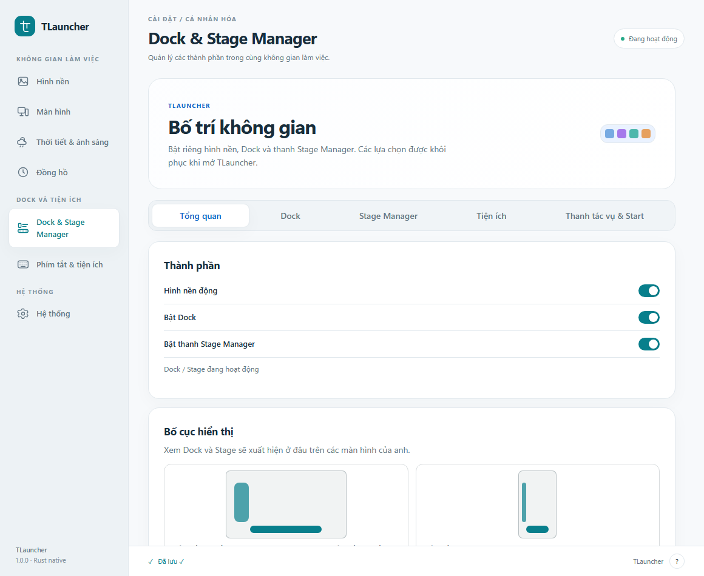
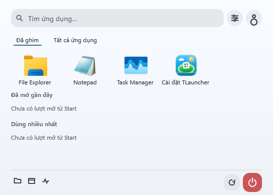

# TLauncher 1.0

TLauncher là ứng dụng Windows 11 tích hợp **Dock, Stage Manager và hình nền động** trong một chương trình Rust native. Mỗi thành phần có thể bật hoặc tắt riêng. Dock và Stage có thể bố trí khác nhau trên từng màn hình, kể cả khi một màn hình đặt dọc.

| Hình nền Đồi cỏ | Hình nền Maldives |
| --- | --- |
|  |  |

*Giao diện Cài đặt với ví dụ bố cục hai màn hình.*

*Menu Start trong kiểm thử Windows với hồ sơ mẫu.*

## Tính năng

| Thành phần | Có thể làm gì |
| --- | --- |
| **Dock** | Ghim ứng dụng, shortcut hoặc lệnh có tham số; quản lý cửa sổ đang mở; đổi icon, cỡ thanh, vị trí, phóng đại và hiệu ứng kính. Bố trí nổi, giữ chỗ hoặc ẩn khi cửa sổ phóng tối đa. |
| **Stage Manager** | Xem trước cửa sổ dạng phối cảnh hoặc phẳng, nhóm nhiều cửa sổ, chuyển giữa các thành viên bằng mũi tên. Chỉnh số thẻ mỗi trang, chiều cao, cạnh và khoảng cách riêng cho từng màn hình. Windows có thể giới hạn ảnh xem trước với cửa sổ được bảo vệ. |
| **Start và Spotlight** | Tìm và mở ứng dụng bằng bàn phím, ghim mục ưa thích, xem ứng dụng gần đây và dùng thường xuyên. Có tùy chọn dùng một lần nhấn phím Windows để mở Start của TLauncher trong chế độ Dock. |
| **Tiện ích** | Trung tâm điều khiển, âm lượng, mạng, Bluetooth, lịch tháng và chỉ số CPU/RAM/GPU/tốc độ mạng. Có thể ẩn riêng các nút và chỉ số trên Dock. |
| **Hình nền** | 16 chủ đề, điều chỉnh thời tiết và ánh sáng, chọn cảnh độc lập hoặc panorama qua nhiều màn hình. Bộ dựng hình giảm hoạt động khi desktop bị che hoặc khóa. |
| **Đồng hồ và phím tắt** | Đồng hồ native theo màn hình; cấu hình phím tắt cho Spotlight, chụp ảnh, quay màn hình và khóa Windows. |
| **Cài đặt** | Dock & Stage Manager chia thành Tổng quan, Dock, Stage Manager, Tiện ích, và Thanh tác vụ & Start. Dock và Stage hỗ trợ màu sáng, tối hoặc theo hệ thống. |

## Cài đặt và cập nhật

1. Mở [GitHub Actions](https://github.com/tuanngbc/Deskland-VN-Custom/actions/workflows/build-rust-test.yml), chọn lượt build Windows thành công của bản cần thử, tải artifact **TLauncher-Rust-win-x64** và giải nén tệp ZIP bên trong. Tệp SHA-256 đi kèm dùng để đối chiếu bản tải.
2. Giữ **toàn bộ thư mục đã giải nén** cạnh TLauncher.exe, đặc biệt là prototype và assets/widget. Mở TLauncher.exe; chọn Cài đặt từ Dock hoặc khay hệ thống. Có thể mở trực tiếp bằng TLauncher.exe --settings.
3. Khi nâng cấp, thoát ứng dụng cũ trước. Sao lưu thư mục cài đặt và %USERPROFILE%\.deskland-rs; giữ nguyên thư mục cấu hình này để sử dụng lại chủ đề, phím tắt và các mục đã lưu. Nếu cần quay lại, thoát bản mới rồi mở EXE từ thư mục đã sao lưu.

Ở chế độ Dock, Explorer vẫn chạy. Nhấn **Ctrl+Alt+Shift+F12** để trả thanh tác vụ cho Windows. Chọn **Tương thích Windows** nếu cần dùng Start hoặc các biểu tượng bên thứ ba theo đúng hành vi của Windows; không phải ứng dụng khay nào cũng thao tác được trong bảng riêng của TLauncher.

## Mã nguồn và kiểm thử

| Đường dẫn | Nội dung |
| --- | --- |
| [src/](src/) | Tiến trình Rust, hình nền, tích hợp Win32 và đồng hồ |
| [src/dock/](src/dock/) · [src/launcher/](src/launcher/) | Dock, Stage, các bảng tiện ích và Start |
| [prototype/](prototype/) · [assets/](assets/) | Giao diện Cài đặt, chủ đề, shader, icon và tài nguyên |
| [tests/](tests/) · [docs/](docs/README.md) | Kiểm thử, kiến trúc, hướng dẫn và bằng chứng nghiệm thu |
| [Workflow Windows](.github/workflows/build-rust-test.yml) | Kiểm thử và đóng gói Windows x64 |

Cần Rust stable và Windows SDK. Chạy **cargo test --release**, sau đó **cargo build --release** để tạo target/release/TLauncher.exe. Chạy từ thư mục gốc khi phát triển để ứng dụng tìm thấy tài nguyên.

TLauncher phát triển từ Deskland/Deskland-VN theo [GPL-3.0](LICENSE). Xem [ghi nhận tác giả](NOTICE), [thông báo bên thứ ba](THIRD_PARTY_NOTICES.md) và [nhãn hiệu](TRADEMARKS.md).
