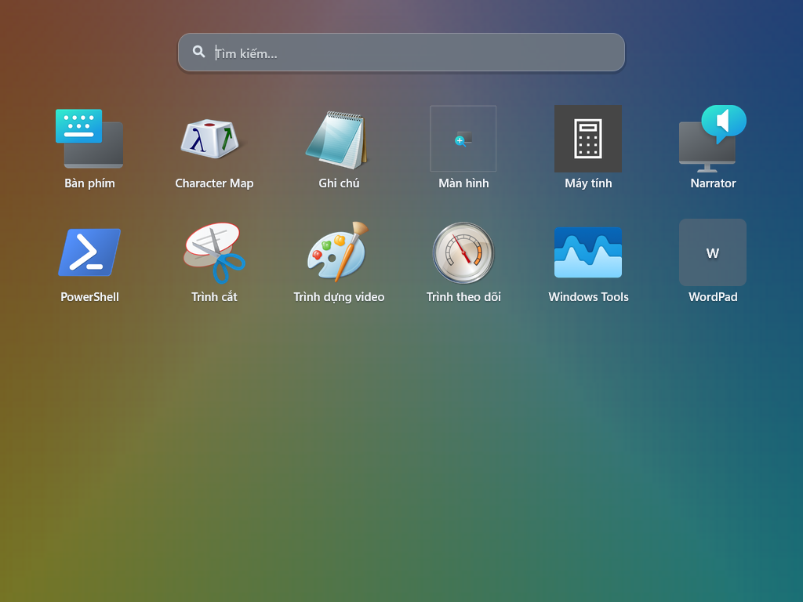
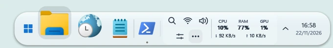

<p align="center">
  <picture>
    <source media="(prefers-color-scheme: dark)" srcset="assets/branding/logo-dark.png">
    
  </picture>
</p>

<p align="center"><strong>Your Windows. Your Workspace.</strong></p>

<p align="center">
  <a href="https://github.com/tuanngbc/TLauncher/releases/latest"></a>
  <a href="https://github.com/tuanngbc/TLauncher/releases/latest"></a>
  <a href="README-rust.md"></a>
  <a href="LICENSE"></a>
  <a href="https://github.com/tuanngbc/TLauncher/releases"></a>
  <a href="https://github.com/tuanngbc/TLauncher/stargazers"></a>
</p>

**Tiếng Việt** · [English](README.en.md) · [简体中文](README.zh-CN.md)

# Biến Windows thành không gian làm việc của riêng bạn

Bạn có thể yêu thích cách Windows hoạt động nhưng vẫn muốn một desktop gọn gàng hơn, một thanh Dock đẹp mắt, hay một cách nhanh hơn để tìm ứng dụng và chuyển giữa các cửa sổ. **TLauncher** được tạo ra cho những nhu cầu đó.

TLauncher là ứng dụng desktop miễn phí, mã nguồn mở dành cho Windows 11, viết chủ yếu bằng Rust native. Kết hợp Dock và Stage Manager lấy cảm hứng từ macOS, Spotlight, hình nền động và các tiện ích thường dùng, TLauncher giúp bạn sắp xếp lại không gian làm việc mà vẫn giữ được môi trường Windows quen thuộc. Bạn có thể dùng tất cả hoặc chỉ bật những thành phần mình thích.

**[⬇ Tải TLauncher cho Windows 11 x64](https://github.com/tuanngbc/TLauncher/releases/latest)** · [Có gì mới trong v1.0.2](docs/releases/v1.0.2.vi.md) · [Báo lỗi & góp ý](https://github.com/tuanngbc/TLauncher/issues)


*Ảnh Windows 11 thực tế từ phiên bản trước, với màn hình ngang 2560×1080 và màn dọc 1080×1920; thông tin cá nhân trên desktop đã được che.*

## Khám phá TLauncher

| Làm việc | Cá nhân hóa | Tiện ích |
| --- | --- | --- |
| Spotlight, thư viện ứng dụng, Dock, Stage Manager, Start Menu | 16 hình nền động, thời tiết, ánh sáng theo giờ, đa màn hình, hai đồng hồ | Trung tâm điều khiển, lịch, chỉ số hệ thống, chụp và chỉnh sửa ảnh, quay MP4 |

[Spotlight](#spotlight--tìm-nhanh-và-mở-mọi-ứng-dụng) · [Các tính năng khác](#dock--ứng-dụng-yêu-thích-luôn-trong-tầm-tay) · [Cài đặt](#bắt-đầu-chỉ-trong-vài-bước) · [Phím tắt](#phím-tắt-hữu-ích) · [FAQ](#câu-hỏi-thường-gặp)

<!-- product-guide:start -->
## Spotlight — tìm nhanh và mở mọi ứng dụng

Điểm nhấn của **v1.0.2** là Unified Spotlight. Thay vì phải nhớ ứng dụng nằm ở đâu hay mở nhiều menu, bạn có thể tìm ngay bằng bàn phím hoặc mở một thư viện toàn màn hình để xem mọi ứng dụng đã được phát hiện.



Có hai cách sử dụng, trên cùng một hệ thống tìm kiếm:

- **Compact Spotlight:** nhấn `Alt + Space`, gõ tên ứng dụng, tệp đã được lập chỉ mục hoặc công cụ hệ thống. Dùng phím mũi tên để chọn và Enter để mở.
- **Fullscreen Spotlight:** bấm kính lúp trên Dock để mở thư viện trên màn hình đó. Cuộn để chuyển trang hoặc dùng bàn phím; bấm ứng dụng để mở, bấm vùng trống hoặc Esc để đóng.

Nhấn **F6** để chuyển giữa hai chế độ mà không mất từ khóa đang nhập. Bạn cũng có thể đặt phím tắt mở toàn màn hình, Dock mở thu gọn, hoặc cho Dock dùng cùng chế độ với phím tắt tại **Cài đặt → Phím tắt & tiện ích → Unified Spotlight**.

### Một thư viện ứng dụng theo cách của bạn

Không chỉ mở ứng dụng, Spotlight còn cho phép bạn tổ chức lại chúng. Thư viện tự phát hiện ứng dụng từ Start Menu và Windows AppsFolder, đồng thời lọc các shortcut không phù hợp và các mục trùng lặp có thể nhận diện.

| Thư mục trong giao diện tối | Chỉnh sửa bố cục |
| --- | --- |
|  |  |

Bấm chuột phải lên ứng dụng để xem các thao tác như đổi tên, đổi icon, yêu thích, ghim Dock hoặc ẩn mục. Từ menu quản lý thư viện, bạn có thể thêm file `.exe` hoặc `.lnk` (kể cả phần mềm portable); vào chế độ chỉnh sửa bố cục để sắp xếp và kéo ứng dụng vào thư mục. Khôi phục mục đã ẩn từ phần **Mục đã ẩn** trong Cài đặt. Việc ẩn hoặc bỏ mục tự thêm không xóa hay gỡ cài đặt ứng dụng gốc.

### Kính mờ, chữ dễ đọc và chuyển động theo sở thích

Spotlight 1.0.2 có giao diện sáng/tối, ô tìm kiếm bo góc đồng nhất, chữ trắng ngà với bóng nhẹ và hệ thống cache icon giúp giảm việc tải lại icon mỗi lần mở. Hiệu ứng kính mờ dùng khả năng compositing của Windows khi tương thích; có chế độ dự phòng nếu không khả dụng.

| Tìm kiếm ở giao diện sáng | Tìm kiếm ở giao diện tối |
| --- | --- |
|  |  |

Trong **Cài đặt → Hiệu ứng chuyển động**, chọn tốc độ từ **0,25× đến 2×**, mặc định hồ sơ mới là **0,70×**. Tốc độ chung áp dụng cho các chuyển động được hỗ trợ của Spotlight, Dock, Start, menu và các bảng tiện ích. Bạn cũng có thể tắt animation hoặc để TLauncher tôn trọng tùy chọn giảm chuyển động của Windows.

*Các ảnh Spotlight 1.0.2 là ảnh giao diện native từ kiểm thử Windows với dữ liệu mẫu, không phải mockup. Ảnh lưới dùng nền kiểm thử và không chứng minh kính mờ trực tiếp trên desktop. [Nguồn ảnh](docs/images/showcase/v1.0.2/README.md).*

## Dock — ứng dụng yêu thích luôn trong tầm tay

Dock đưa những ứng dụng bạn dùng nhiều nhất đến một nơi dễ truy cập. Ghim ứng dụng, shortcut hoặc lệnh tùy chỉnh có đối số; bấm icon để mở hoặc chuyển cửa sổ. Icon phóng nhẹ khi rê chuột, Dock co giãn theo nội dung và có thể tự ẩn để dành không gian cho cửa sổ lớn.



Trong **Cài đặt → Dock & Stage Manager**, hãy chọn màn hình, cạnh đặt Dock, kích thước icon, khoảng cách, độ phóng, kính mờ và chế độ sáng/tối. Dock có thể nổi trên desktop, dành riêng vùng làm việc hoặc tự ẩn khi cửa sổ phóng tối đa. Mỗi màn hình có thể dùng bố trí riêng.

## Stage Manager — chuyển cửa sổ mà không mất dấu công việc

Khi mở nhiều ứng dụng, Stage Manager đưa các cửa sổ thành những thẻ xem trước ở cạnh màn hình. Bấm thẻ để chuyển sang cửa sổ tương ứng; dùng mũi tên để duyệt thành viên trong nhóm. Thẻ có thể hiển thị dạng phẳng hoặc phối cảnh, với kích thước, số thẻ mỗi trang và vị trí tùy chỉnh.


Cửa sổ có nội dung được Windows bảo vệ có thể không cung cấp ảnh xem trước. v1.0.2 vẫn dùng hiệu ứng thu nhỏ/phục hồi cửa sổ chuẩn Windows; Stage Peek và Genie chưa có trong bản này.

## Start Menu — một lối vào quen thuộc

Start hiển thị ứng dụng ghim, gần đây, dùng nhiều và các tùy chọn tài khoản, nguồn. Ô tìm kiếm sẵn sàng nhận bàn phím khi mở. Trong chế độ Dock, nhấn riêng phím Windows có thể mở Start của TLauncher; nếu thích Start và taskbar gốc, chọn **Tương thích Windows**.


## Hình nền động — để desktop sống động hơn

TLauncher có **16 chủ đề tương tác**: từ bãi biển, Maldives, hồ cá và thảo nguyên đến sân vận động, đại dương hay hiên nhà mùa hè. Tùy cảnh, một cú bấm trên vùng trống có thể tạo gợn nước, gọi cá hoặc tạo mây; icon desktop vẫn hoạt động bình thường.

| Bãi biển | Maldives | Thảo nguyên |
| --- | --- | --- |
|  |  |  |

Mở **Cài đặt → Hình nền** để chọn chủ đề và chỉnh tham số. Nhiều cảnh có bố cục dành chỗ cho các cụm icon desktop. Không thích hình nền động? Bạn có thể tắt riêng wallpaper mà vẫn dùng Dock, Stage và Spotlight.

### Thời tiết, ánh sáng và bóng đổ theo thời gian

Thay vì luôn nhìn một cảnh cố định, bạn có thể để ánh sáng chuyển theo thời gian trong ngày, mô phỏng nắng, mây, mưa, tuyết và gió. Trong **Cài đặt → Thời tiết & ánh sáng**, chọn thời tiết thủ công, mô phỏng ngoại tuyến hoặc tìm thành phố/mã bưu chính để dùng dữ liệu Open-Meteo. Những cảnh hỗ trợ bóng đổ sẽ thay đổi hướng và độ dài bóng theo vị trí Mặt Trời. Thời tiết và ánh sáng theo giờ có thể bật/tắt riêng.


## Đa màn hình — không gian rộng hơn, bố trí linh hoạt hơn

Dù bạn dùng một màn hình, hai màn ngang hay kết hợp ngang và dọc, TLauncher cho phép chọn cách hình nền được bố trí tại **Cài đặt → Màn hình**:

| Chế độ | Cách hoạt động |
| --- | --- |
| Đồng bộ | Cùng chủ đề trên mọi màn hình |
| Độc lập | Chọn chủ đề riêng cho từng màn |
| Toàn cảnh | Trải cảnh theo vị trí thực của màn hình trong Windows |


Có thể tạm dừng hình nền từng màn hình, đặt Dock và Stage riêng, kể cả bố trí có DPI khác nhau.

### Hai đồng hồ desktop

Thêm đồng hồ hiển thị giờ, thứ và ngày dưới các cửa sổ. Tại **Cài đặt → Đồng hồ**, bật đồng hồ thứ hai nếu muốn, chọn màn hình, kích thước, độ trong mờ và các dòng thông tin. Mở khóa để kéo đến vị trí mong muốn, sau đó khóa lại để thao tác chuột xuyên qua đồng hồ.


## Tiện ích hằng ngày — ngay trên desktop

**Trung tâm điều khiển:** mở từ mũi tên trên Dock để chỉnh âm lượng và truy cập tiện ích mạng/Bluetooth. Bấm ngày giờ để mở lịch tháng; bật hoặc tắt các chỉ số CPU, GPU, RAM, mạng và cụm trạng thái theo nhu cầu.

| Lịch tháng | Chỉ số tài nguyên trên Dock |
| --- | --- |
|  |  |

**Chụp và chỉnh sửa ảnh:** nhấn `Ctrl + Shift + S`, kéo vùng cần chụp hoặc nhấn Space để chọn cả màn hình dưới chuột. Trình sửa có cắt, mũi tên, chữ, số bước, che pixel và tô kín; sao chép hoặc lưu PNG/JPG.

**Quay màn hình:** nhấn `Ctrl + Shift + R`, chọn vùng quay và nhấn lại để dừng. Có MP4/H.264 ở 30 hoặc 60 FPS, tùy chọn âm thanh phát từ máy, tạm dừng/tiếp tục bằng `Ctrl + Shift + P`. Chưa hỗ trợ mic, webcam hoặc chế độ quay game riêng.


## Tùy chỉnh theo ý bạn

Cài đặt tích hợp bằng tiếng Việt, English và 简体中文 cho phép bật/tắt Hình nền, Dock và Stage độc lập, tùy chỉnh màn hình, theme, phím tắt, tốc độ chuyển động và khởi động cùng Windows. Một số nhãn native vẫn có thể khác ngôn ngữ. Explorer tiếp tục hoạt động; dùng chế độ **Tương thích Windows** để sử dụng đầy đủ taskbar và khay hệ thống gốc, kể cả icon ứng dụng bên thứ ba.


*Ảnh các chức năng ngoài Spotlight ở trên đến từ các bản trước hoặc kiểm thử native; bố cục và nhãn có thể khác một chút trong 1.0.2.*
<!-- product-guide:end -->

## Bắt đầu chỉ trong vài bước

**Yêu cầu:** Windows 11 x64, driver hỗ trợ OpenGL 3.3 cho hình nền và Microsoft Edge WebView2 Runtime cho Cài đặt đầy đủ. Không cần cài Rust hay công cụ lập trình.

1. Tải [gói Windows x64](https://github.com/tuanngbc/TLauncher/releases/latest) trong Assets (không phải Source code). Với v1.0.2, tên gói là `TLauncher-1.0.2-win-x64.zip`; có [SHA-256](https://github.com/tuanngbc/TLauncher/releases/download/v1.0.2/TLauncher-1.0.2-win-x64.zip.sha256) để kiểm tra.
2. Giải nén **toàn bộ** vào thư mục bạn muốn giữ lâu dài. Không tách riêng EXE khỏi `prototype/`, `assets/widget/` và tài nguyên đi kèm.
3. Chạy `TLauncher.exe`, mở Cài đặt từ Dock hoặc khay hệ thống. Chọn hình nền, bật các thành phần muốn dùng và thử Alt+Space.
4. Nếu muốn chạy mỗi lần đăng nhập, bật **Cài đặt → Hệ thống → Khởi động cùng Windows**. TLauncher đăng ký qua Task Scheduler theo tài khoản hiện tại, không cần quyền quản trị.

### Thiết lập để có trải nghiệm đẹp nhất

| Thiết lập | Khuyến nghị |
| --- | --- |
| Kính mờ Windows | **Cài đặt → Cá nhân hóa → Màu sắc → Hiệu ứng trong suốt: Bật** |
| Animation Windows | **Trợ năng → Hiệu ứng hình ảnh → Animation effects: Bật** nếu thích chuyển động |
| Animation TLauncher | Bật, thử **0,70×**, chỉnh theo sở thích |
| Spotlight | Alt+Space: Compact; kính lúp Dock: Fullscreen (hoặc tùy chọn riêng) |
| Theme | Sáng, tối hoặc theo hệ thống |
| Hiệu ứng cửa sổ | Giữ mặc định Windows |

Các tùy chọn trên là khuyến nghị, không phải điều kiện bắt buộc để chạy phần mềm. Có thể mở nhanh trang hiệu ứng Windows bằng Win+R → `ms-settings:easeofaccess-visualeffects`. Nếu từng tắt animation thu nhỏ/phóng to để thử bản Scale, bật lại mục **Animate windows when minimizing and maximizing** trong Win+R → `SystemPropertiesPerformance.exe` → Visual Effects.

### Nâng cấp hoặc quay lại bản trước

Thoát bản cũ, sao lưu thư mục cài đặt và `%USERPROFILE%\.deskland-rs`, rồi giải nén đầy đủ gói mới. Giữ hồ sơ để dùng tiếp hình nền, mục ghim, cấu hình màn hình và phím tắt. Nếu đổi đường dẫn EXE, tắt rồi bật lại tự khởi động để cập nhật Task Scheduler. Muốn quay lại 1.0.1, tắt startup bản mới trước khi thoát, khôi phục gói và hồ sơ sao lưu phù hợp, rồi bật startup lại nếu muốn. Bản cũ có thể không hiểu dữ liệu thư viện mới.

## Phím tắt hữu ích

| Phím mặc định | Tác vụ |
| --- | --- |
| Alt + Space | Mở/đóng Spotlight |
| F6 | Đổi Compact/Fullscreen khi Spotlight đang mở |
| Esc | Quay lại từ thư mục hoặc đóng Spotlight |
| ↑ ↓ ← → / Enter | Chọn và mở kết quả |
| Ctrl + Shift + S | Chụp màn hình |
| Ctrl + Shift + R | Bắt đầu hoặc kết thúc quay |
| Ctrl + Shift + P | Tạm dừng hoặc tiếp tục quay |
| Ctrl + Alt + L | Khóa Windows |
| Ctrl + Alt + Shift + F12 | Hiện lại taskbar Windows trong phiên hiện tại |

Đổi phím Spotlight, chụp/quay và khóa trong **Phím tắt & tiện ích**.

## Được thiết kế để chạy cùng desktop

TLauncher dùng Rust và Win32 cho phần desktop, OpenGL 3.3/WGL cho hình nền, Direct3D 11/DirectComposition khi tương thích và GDI làm dự phòng. WebView2 phục vụ Cài đặt khi cần; Windows Graphics Capture và Media Foundation hỗ trợ các đường chụp/quay tương thích.

Hình nền thường chạy khoảng 30 FPS, có thể tăng khi tương tác và giảm/dừng công việc dựng hình khi bị che, khóa phiên hoặc màn hình tắt. v1.0.2 tập trung tái sử dụng icon, giới hạn cache preview, dùng chung bộ dựng đồ họa và thu hồi bề mặt Spotlight khi đóng. Mục tiêu là giữ desktop phản hồi tốt mà không phải duy trì công việc đồ họa không cần thiết.

Chưa có benchmark toàn ứng dụng đủ để cam kết RAM 100–150 MiB, GPU 3% hay CPU 1% trên mọi cấu hình. [Báo cáo tối ưu tài nguyên](docs/TLAUNCHER_RESOURCE_OPTIMIZATION_REPORT.md) trình bày phép đo và giới hạn; kết quả phụ thuộc hình nền, số màn hình, driver và chức năng đang mở.

## Câu hỏi thường gặp

**Kính mờ không xuất hiện?** Kiểm tra Transparency effects. Native glass phụ thuộc Windows compositor và driver; khi không khả dụng, TLauncher có thể dùng nền snapshot làm mờ hoặc nền đặc. High Contrast được tôn trọng.

**Vì sao một ứng dụng không hiện trong Spotlight?** Một số shortcut không phải ứng dụng được lọc. Bạn có thể thêm EXE/LNK thủ công hoặc kiểm tra danh sách đã ẩn.

**Vì sao Cài đặt chỉ có giao diện cơ bản?** Kiểm tra WebView2 Runtime và thư mục `prototype/` cạnh EXE.

**Có thể quay lại desktop Windows gốc không?** Chọn Tương thích Windows hoặc Ctrl+Alt+Shift+F12 để hiện taskbar trong phiên. Chọn Thoát trong menu TLauncher để kết thúc ứng dụng.

**Không thấy TLauncher ở danh sách Startup apps?** Từ 1.0.1, tự khởi động được đăng ký qua Task Scheduler; dùng công tắc trong Cài đặt TLauncher.

**Scale/Genie có sẵn không?** Không. Scale chưa ổn định trên máy thử thực tế và được ẩn ở bản công khai. Windows xử lý thu nhỏ/phục hồi như bình thường. Chất lượng kính, IME và một số chức năng preview còn phụ thuộc môi trường Windows.

## Quyền riêng tư

Khi chọn thời tiết trực tiếp, truy vấn thành phố và tọa độ đã chọn được gửi tới Open-Meteo; ứng dụng không tự lấy vị trí thiết bị cho tính năng này. Có thể dùng mô phỏng ngoại tuyến. Ảnh và video mặc định lưu cục bộ trong `Pictures/TLauncher` và `Videos/TLauncher`. Windows có thể chặn chụp nội dung được bảo vệ.

## Dành cho người phát triển và cộng đồng

TLauncher là dự án mã nguồn mở độc lập, không liên quan đến Minecraft launcher cùng tên và không phải sản phẩm chính thức của Apple hay Microsoft.

Muốn tự build? Dùng Rust stable, C++ MSVC và Windows SDK trên Windows:

```powershell
cargo test --release
cargo build --release
```

Xem [hướng dẫn Rust](README-rust.md), [tài liệu kỹ thuật](docs/README.md), [quy ước đóng góp](AGENTS.md) và [nhật ký thay đổi](CHANGELOG.md). Gói release chứa `VERSION.txt` và `BUILD-COMMIT.txt`.

Nếu có ý tưởng hoặc gặp lỗi, hãy [mở issue](https://github.com/tuanngbc/TLauncher/issues) kèm phiên bản, Windows build, bố trí màn hình và cách tái hiện. Vui lòng che dữ liệu riêng tư trong ảnh/log.

## Ghi nhận

TLauncher được phát triển và duy trì bởi [tuanngbc](https://github.com/tuanngbc), kế thừa nền tảng hình nền động từ [BLEZZ0102/Deskland](https://github.com/BLEZZ0102/Deskland) và các chủ đề, bản địa hóa tiếng Việt từ [nhhoang188/Deskland-VN](https://github.com/nhhoang188/Deskland-VN). Dự án mở rộng bằng bộ dựng hình Rust native, đa màn hình, quản lý cửa sổ, launcher và tiện ích desktop.

Cảm ơn các tác giả và cộng đồng mã nguồn mở đã xây dựng nền tảng cho dự án. Xem [NOTICE](NOTICE), [Deskland-VN NOTICE](third_party/deskland-vn/NOTICE) và [nguồn thiết kế đồng hồ](assets/widget/NOTICE.txt).

**Giấy phép:** [GNU GPL-3.0](LICENSE) · [Thông báo bên thứ ba](THIRD_PARTY_NOTICES.md) · [Nhãn hiệu](TRADEMARKS.md) · [Quy chuẩn thương hiệu](assets/branding/BRAND.md).
