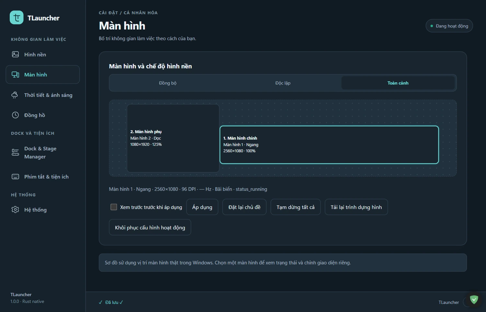
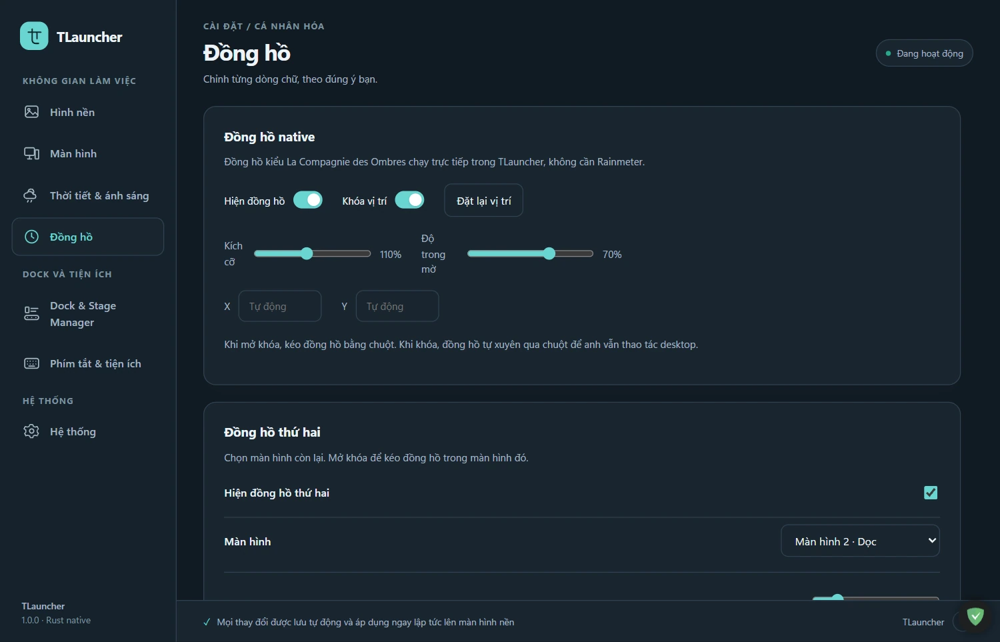
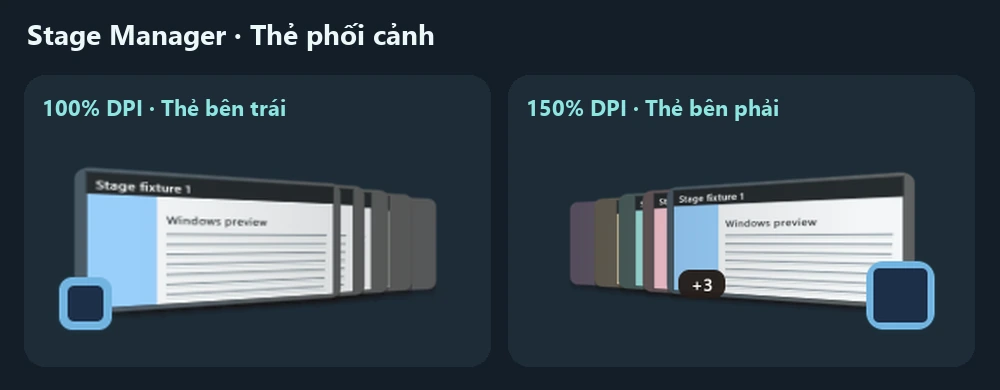
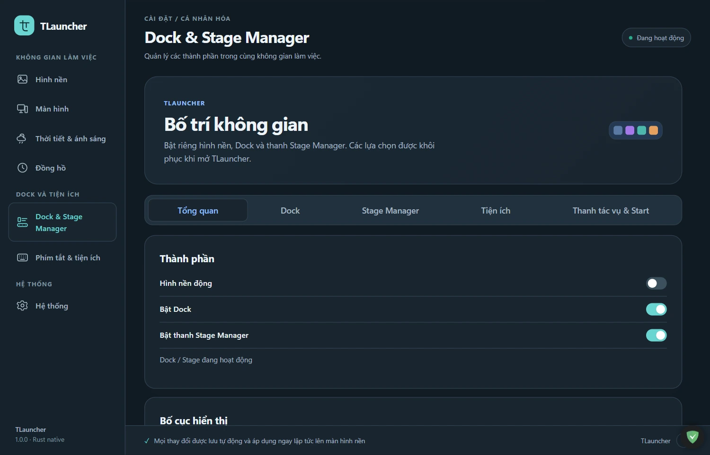

# TLauncher · Không gian làm việc cho Windows 11

TLauncher mang **hình nền động, Dock, Stage Manager và Spotlight lấy cảm hứng từ macOS** vào cùng một ứng dụng Rust dành cho Windows 11. Ghim ứng dụng trên Dock, chuyển cửa sổ từ các thẻ Stage và tìm nhanh bằng Spotlight. Hình nền, Dock và Stage có thể bật hoặc tắt riêng.

**[Tải bản mới nhất cho Windows 11 x64](https://github.com/tuanngbc/TLauncher/releases/latest)** · [Nhật ký thay đổi](CHANGELOG.md)

**Mới trong 1.0.1:** TLauncher tự mở khi đăng nhập Windows nếu đã bật tùy chọn tương ứng. Dock và Stage Manager khởi tạo trước, trong khi hình nền chờ Explorer sẵn sàng.

*Ảnh chụp trên Windows 11. Hai màn chạy chung cảnh Bãi biển, ghép đúng tỷ lệ và vị trí theo bố trí màn hình trong Windows. Mỗi màn có Dock riêng. Các cụm icon vẫn tạo hình đảo; chỉ biểu tượng và tên tệp trên desktop được che. Các thẻ xem trước của Stage Manager vẫn hiện ở cạnh phải.*

<!-- product-guide:start -->
## Hình nền động và tương tác

Chọn trong **16 chủ đề**, từ bãi biển, thảo nguyên và hồ cá đến sân vận động, đại dương và hiên nhà mùa hè. Nhiều cảnh uốn quanh biểu tượng desktop. Tùy cảnh, bấm vùng trống có thể tạo gợn nước, gọi cá hoặc tạo cụm mây; bấm biểu tượng vẫn mở ứng dụng như bình thường. Chọn **Cài đặt → Hình nền** để đổi cảnh, chỉnh tham số hoặc tạo bố cục mới.

| Bãi biển | Đảo Maldives | Thảo nguyên |
| --- | --- | --- |
|  |  |  |

*Ảnh xem trước từ ba chủ đề đi kèm.*

## Thời tiết thật, ánh sáng và bóng đổ

Trong **Cài đặt → Thời tiết & ánh sáng**, có thể dùng mô phỏng ngoại tuyến hoặc chọn **Theo vị trí thật**, rồi tìm thành phố hoặc mã bưu chính. Chế độ trực tiếp lấy mây, mưa, tuyết và gió từ Open-Meteo cho địa điểm đã chọn; ứng dụng không tự lấy vị trí thiết bị. Có thể chọn kiểu trời như quang đãng, nhiều mây, mưa, giông hoặc tuyết.

Khi bật **Đổi theo thời gian**, TLauncher tính hướng và độ cao Mặt Trời từ thời điểm hiện tại và tọa độ đã chọn. Nếu chưa chọn địa điểm, ứng dụng dùng giờ trên máy. Cảnh có hỗ trợ bóng cây, chẳng hạn **Bãi biển**, dùng hướng nắng để đổi hướng và độ dài bóng; mỗi cảnh có hiệu ứng riêng. Có thể bật hoặc tắt diễn biến theo giờ và theo thời tiết độc lập.

*Ảnh giao diện với thành phố mẫu. Sơ đồ bên dưới minh họa hướng bóng đổi theo giờ.*

## Nhiều màn hình: đồng bộ, độc lập hoặc toàn cảnh

Dùng **Đồng bộ** để dùng cùng chủ đề trên các màn, **Độc lập** để chọn cảnh riêng hoặc **Toàn cảnh** để trải một cảnh liên tục qua các màn. Sơ đồ đọc bố trí từ Windows, kể cả cặp ngang–dọc và các màn có mức thu phóng khác nhau. Có thể tạm dừng nền từng màn và chọn màn nào hiển thị Dock hoặc Stage với kích cỡ, cạnh và cách giữ chỗ riêng.

*Ảnh Cài đặt với hai màn hình mẫu ở mức 100% và 125%.*

## Hai đồng hồ trên desktop

Đồng hồ native hiển thị giờ, thứ và ngày trên desktop, phía sau cửa sổ ứng dụng. Mở khóa để kéo đồng hồ, rồi khóa vị trí để chuột đi xuyên qua. Chỉnh kích cỡ và độ trong mờ hoặc tinh chỉnh từng dòng. Có thể bật đồng hồ thứ hai trên màn còn lại và chỉnh kích cỡ, vị trí riêng ở **Cài đặt → Đồng hồ**.

*Ảnh Cài đặt với đồng hồ thứ hai bật trên màn dọc mẫu.*

## Dock kiểu macOS

Ghim ứng dụng, shortcut hoặc lệnh có đối số; mở và chuyển cửa sổ từ biểu tượng trên Dock. Có tùy chọn đổi icon, kích cỡ, khoảng cách, mức phóng khi rê chuột, kính mờ và màu sáng, tối hoặc theo hệ thống. Dock có thể nổi trên cửa sổ, giữ chỗ để cửa sổ phóng lớn không che thanh, hoặc tự ẩn khi cửa sổ phóng tối đa rồi hiện lại khi rê vào cạnh. Bố trí chỉnh riêng theo màn hình.

*Ảnh chụp native từ lượt thử Dock, dùng hồ sơ mẫu.*

## Stage Manager: nhóm và chuyển cửa sổ bằng thẻ

Stage xếp ảnh xem trước ở cạnh trái hoặc phải, dạng thẻ phối cảnh hoặc phẳng. Thẻ của cửa sổ đang làm việc được làm nổi bật. Khi nhiều cửa sổ chung một thẻ, hai mũi tên cho phép chọn cửa sổ cần mở. Có thể chỉnh số thẻ mỗi trang, cỡ thẻ, khoảng cách đến cạnh màn và vùng làm việc. Bản 1.0.0 khử răng cưa viền chéo, kể cả khi rê chuột phóng thẻ; kiểm thử Windows bao phủ DPI **100%, 125% và 150%**. Windows có thể giới hạn ảnh xem trước của cửa sổ được bảo vệ.

*Ảnh kiểm thử native của bản phát hành với các cửa sổ mẫu.*

## Start và Spotlight

**Start** có ô tìm kiếm tự nhận bàn phím, ứng dụng ghim, mục mở gần đây và dùng nhiều nhất. Từ đây có thể mở tùy chọn tài khoản và nguồn. Trong chế độ Dock, có thể dùng một lần nhấn phím **Windows** để mở Start của TLauncher. **Spotlight** là ô tìm kiếm riêng, mở giữa màn hình bằng nút kính lúp hoặc **Alt+Space** mặc định. Spotlight tìm ứng dụng và tệp từ các vị trí được lập chỉ mục; dùng mũi tên để chọn và Enter để mở.

| Start của TLauncher | Spotlight |
| --- | --- |
|  |  |

*Start chụp từ kiểm thử 1.0.0; Spotlight chụp từ lượt thử native trước khi đổi tên sản phẩm.*

## Trung tâm điều khiển, lịch và chỉ số hệ thống

Mở **Trung tâm điều khiển** bằng mũi tên trên Dock để xem tiện ích, điều chỉnh âm lượng và truy cập mạng, Bluetooth. Bấm ngày giờ để mở **lịch tháng** và chuyển tháng. Dock có thể hiện **CPU, RAM, GPU và tốc độ tải lên/xuống**; chỉ số và cụm nút mạng/âm lượng có công tắc hiển thị riêng. Chọn **Tương thích Windows** nếu cần thao tác đầy đủ với biểu tượng khay của ứng dụng bên thứ ba.

| Lịch tháng | Vùng chỉ số và tiện ích |
| --- | --- |
|  |  |

*Lịch chụp từ kiểm thử 1.0.0; vùng chỉ số cắt từ ảnh Dock thử nghiệm. Các số trong ảnh giao diện không phải số đo bên dưới.*

## Chụp ảnh và quay màn hình

| Phím mặc định | Tác vụ |
| --- | --- |
| **Ctrl+Shift+S** | Kéo chọn vùng chụp; Space chọn cả màn hình dưới con trỏ. Trình sửa ảnh có cắt, mũi tên, chữ, số bước, che kiểu pixel và tô kín. Sao chép vào clipboard hoặc lưu PNG/JPG. |
| **Ctrl+Shift+R** | Chọn vùng quay và lưu MP4 (H.264), **30 FPS** mặc định hoặc **60 FPS**. Chọn thu tiếng máy hoặc quay im lặng; nhấn lại để dừng và lưu. |
| **Ctrl+Shift+P** | Tạm dừng hoặc tiếp tục bản quay đang chạy. |
| **Alt+Space** | Mở Spotlight. |
| **Ctrl+Alt+L** | Khóa bằng cơ chế khóa của Windows. |
| **Ctrl+Alt+Shift+F12** | Hiện lại thanh tác vụ Windows trong phiên hiện tại. |

Đổi phím Spotlight, chụp, quay và khóa trong **Cài đặt → Phím tắt & tiện ích**. Ảnh và video lưu cục bộ, mặc định trong **Pictures/TLauncher** và **Videos/TLauncher**. Bản quay hỗ trợ tiếng phát từ máy; mic và webcam không nằm trong bản 1.0.0. Nội dung có bảo vệ có thể không được ghi.

*Ảnh Cài đặt của bộ chụp và quay; chưa bắt đầu phiên ghi.*

## Hiệu năng: CPU, GPU và RAM

Hình nền dựng bằng Rust/Win32 và OpenGL. Trên driver tương thích, TLauncher đưa khung từ GPU lên desktop qua D3D11/DirectComposition; GDI là đường dự phòng. Nhịp nền thường khoảng **30 FPS** và có thể tăng ngắn khi tương tác. Màn bị che ngừng nhận khung mới; khi tất cả bị che hoặc khi khóa máy, hình nền tạm dừng dựng. WebView2 dùng khi mở Cài đặt; công cụ chụp và quay chạy theo yêu cầu.

**Mẫu quan sát bản 1.0.0** trên Windows 11, Ryzen 5 4600G, GTX 1070 và hai màn **2560×1080 + 1080×1920**, cảnh Bãi biển ở chế độ Toàn cảnh. Trong **25,5 giây / 18 mẫu**, nhật ký cho thấy **một nền đang bị che**, nền còn lại chạy khoảng **30 FPS**:

| Chỉ số | Quan sát |
| --- | ---: |
| CPU của tiến trình chính TLauncher, chuẩn hóa theo 12 luồng logic | **0,54%** trung bình |
| RAM riêng (private bytes) | **279 MiB** |
| RAM đang lưu trú (working set) | **174–176 MiB** |
| GPU 3D của TLauncher, trên engine đang hoạt động | **1–2%** |
| GPU 3D của DWM, trên cùng engine | **0–1%** |

*GPU là chỉ số theo tiến trình và engine, không phải GPU tổng. Đây là một mẫu quan sát, không phải phép đo đối chứng hay cam kết khi hai nền cùng lộ, đang mở Cài đặt hoặc đang quay.*

## Cá nhân hóa và chế độ thanh tác vụ

Một cửa sổ **Cài đặt** tập trung Hình nền, Màn hình, Thời tiết & ánh sáng, Đồng hồ, Dock & Stage Manager, Phím tắt & tiện ích và Hệ thống. Ở chế độ Dock, **Explorer vẫn chạy**. Chuyển sang **Tương thích Windows** để dùng Start, thanh tác vụ và khay gốc; phím khôi phục ở bảng trên hiện lại thanh Windows ngay trong phiên. Windows vẫn quản lý đăng nhập và màn hình khóa.

*Ảnh giao diện 1.0.0 với cấu hình minh họa.*
<!-- product-guide:end -->

## Cài đặt và cập nhật

1. Mở [Release mới nhất](https://github.com/tuanngbc/TLauncher/releases/latest) và tải **TLauncher-1.0.1-win-x64.zip** trong mục **Assets**. Tệp **.zip.sha256** cùng tên dùng để đối chiếu bản tải. **Source code** dùng để đọc hoặc tự build.
2. Giải nén **toàn bộ** gói vào một thư mục rồi mở **TLauncher.exe**. Giữ **prototype/** và **assets/widget/** cạnh EXE. Mở Cài đặt từ menu Dock hoặc khay hệ thống.
3. Khi nâng cấp, thoát bản cũ, sao lưu thư mục cài đặt và **%USERPROFILE%\.deskland-rs**, rồi giải nén toàn bộ gói mới vào thư mục cài đặt. Giữ thư mục cấu hình để dùng tiếp chủ đề, phím tắt và các mục đã lưu.
4. Nếu muốn tự mở khi đăng nhập, kiểm tra **Cài đặt → Hệ thống → Khởi động cùng Windows**. Nếu chuyển EXE sang thư mục khác hoặc tùy chọn đã bật nhưng máy không tự mở, tắt rồi bật lại công tắc từ bản mới để đăng ký lại đúng đường dẫn. Xem [cách nâng cấp và quay về 1.0.0](CHANGELOG.md#nâng-cấp-và-quay-lại).

## Mã nguồn, kiểm thử và giấy phép

Mỗi gói Windows có **VERSION.txt** và **BUILD-COMMIT.txt** để đối chiếu phiên bản và mã nguồn. Xem [Release mới nhất](https://github.com/tuanngbc/TLauncher/releases/latest) để tìm bản build đã kiểm tra, hoặc đọc [kiến trúc và lệnh kiểm thử](README-rust.md) và [tài liệu](docs/README.md). Dựng trên Windows với Rust stable và Windows SDK: chạy **cargo test --release** và **cargo build --release**.

Dự án dùng [GPL-3.0](LICENSE). Xem [thông báo bên thứ ba](THIRD_PARTY_NOTICES.md) và [ghi chú nhãn hiệu](TRADEMARKS.md).

## Nguồn gốc và ghi nhận phát triển

- **Deskland** — [BLEZZ0102/Deskland](https://github.com/BLEZZ0102/Deskland) là dự án gốc và nền tảng hình nền động.
- **Deskland-VN** — [nhhoang188/Deskland-VN](https://github.com/nhhoang188/Deskland-VN) là nguồn của các chủ đề được chuyển sang TLauncher và phần bản địa hóa tiếng Việt.
- **TLauncher** — [tuanngbc](https://github.com/tuanngbc) phát triển và duy trì bản fork [tuanngbc/TLauncher](https://github.com/tuanngbc/TLauncher). Các tính năng bổ sung gồm Dock, Stage Manager, Start, Spotlight, chế độ thanh tác vụ, trung tâm điều khiển, lịch và chỉ số hệ thống, đồng hồ desktop native, chụp và quay màn hình, phím tắt tùy chỉnh và Cài đặt tích hợp. Trên nền hình nền được kế thừa, tuanngbc phát triển bộ dựng hình Rust và hệ thống đa màn hình của TLauncher: đồng bộ, cảnh riêng từng màn, toàn cảnh nối qua các màn, và bố trí Dock, Stage, đồng hồ theo từng màn. Thời tiết theo vị trí và bóng đổ theo Mặt Trời cũng là phần TLauncher phát triển thêm.

Xem [NOTICE](NOTICE), [ghi nhận gốc của Deskland-VN](third_party/deskland-vn/NOTICE) và [nguồn thiết kế đồng hồ](assets/widget/NOTICE.txt).
