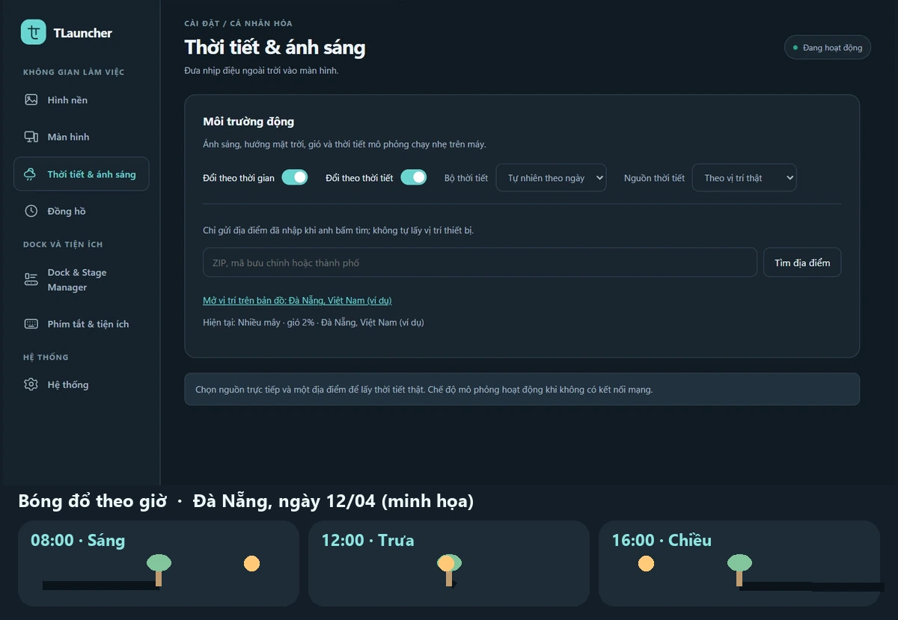

<p align="center">
  <picture>
    <source media="(prefers-color-scheme: dark)" srcset="assets/branding/logo-dark.png">
    <source media="(prefers-color-scheme: light)" srcset="assets/branding/logo-light.png">
    
  </picture>
</p>

<p align="center"><strong>Your Windows. Your Workspace.</strong></p>

[Tiếng Việt](README.md) · [English](README.en.md) · **简体中文**

# TLauncher — 专为 Windows 11 打造的现代桌面工作空间

TLauncher 是一款专为 Windows 11 打造的开源桌面工作空间工具。它采用原生 Rust 开发，将受 macOS 启发的 Dock、台前调度、Spotlight 搜索、交互式动态壁纸和多显示器管理集成于同一个应用程序中。

[](https://github.com/tuanngbc/TLauncher/releases/latest) [](https://github.com/tuanngbc/TLauncher/releases/latest) [](README-rust.md) [](LICENSE) [](https://github.com/tuanngbc/TLauncher/releases) [](https://github.com/tuanngbc/TLauncher/stargazers)

**[下载最新版（Windows 11 x64）](https://github.com/tuanngbc/TLauncher/releases/latest)** · [更新日志](CHANGELOG.md) · [报告问题](https://github.com/tuanngbc/TLauncher/issues) · [源代码](https://github.com/tuanngbc/TLauncher)

## 实际运行截图


*实拍自 Windows 11。拼接图保留两块屏幕的相对比例和位置，每块屏幕都有自己的 Dock。桌面图标的分组仍塑造了岛屿的轮廓。台前调度卡片保留，桌面图标和文件名已遮盖。部分图片来自原生测试版本，界面标签为越南语。*

## 目录

- [实际运行截图](#实际运行截图)
- [什么是 TLauncher](#什么是-tlauncher)
- [主要功能](#主要功能)
- [功能详情与截图](#功能详情与截图)
- [系统要求](#系统要求)
- [安装与升级](#安装与升级)
- [键盘快捷键](#键盘快捷键)
- [性能与资源占用](#性能与资源占用)
- [架构与技术](#架构与技术)
- [隐私与安全](#隐私与安全)
- [常见问题](#常见问题)
- [从源码构建](#从源码构建)
- [反馈与贡献](#反馈与贡献)
- [致谢与上游项目](#致谢与上游项目)
- [许可证](#许可证)

## 什么是 TLauncher

用 Dock 固定和打开应用，用台前调度整理窗口，用 Spotlight 查找应用和文件，也可以分别自定义每块屏幕。壁纸、Dock 和台前调度均可独立开关。TLauncher 是 Windows 桌面应用，与同名 Minecraft 启动器无关。

## 主要功能

| 类别 | 公开版已提供 |
| --- | --- |
| 窗口管理 | Dock、台前调度、开始菜单、Spotlight 搜索及 Windows 任务栏兼容模式 |
| 桌面 | **16 款**交互式动态主题、随时间变化的光照、按地点获取的天气、三种多屏模式和双时钟 |
| 实用工具 | 控制中心、月历、CPU/GPU/内存/网络指标、截图编辑及 MP4 录屏 |
| 个性化 | 集成设置、独立显示器布局、自定义快捷键及登录时自动启动 |

**1.0.1 版：**启用自动启动后，Windows 任务计划程序会在用户登录时启动 TLauncher。Dock 和台前调度先于壁纸初始化；若 Explorer 尚未就绪，壁纸稍后会重新尝试挂载。参见[验证记录和测试条件](CHANGELOG.md#kiểm-chứng)。

## v1.0.2 新功能

**统一 Spotlight**结合快速搜索与应用库。**Alt+Space** 默认打开紧凑模式，Dock 放大镜默认在 Dock 所在屏幕打开全屏模式。两者可分别设置，Dock 也可跟随快捷键。按 **F6** 保留查询并切换模式；按 **Esc** 返回上级文件夹或关闭，点击空白区域退出全屏，滚轮和键盘可翻页。

共享目录从开始菜单发现 Win32 应用，从 Windows AppsFolder 发现打包应用，过滤辅助快捷方式，并搜索应用、已索引文件和系统工具。支持添加 **EXE/LNK**、更名、换图标、收藏、固定至 Dock、隐藏/恢复、排序，以及在编辑布局模式下拖入文件夹。隐藏或移除手动添加的项目不会卸载程序。新配置首次打开设置时可显示引导，也可从 **快捷键和实用工具 → 统一 Spotlight** 重新打开。

**材质和动画。** 全屏优先使用兼容 Windows 上的原生 HostBackdrop/Acrylic；必要时使用内存中一次性模糊快照，关闭透明或启用高对比度时使用纯色后备。浅色/深色主题共享搜索框、象牙白文字、阴影和灰度抗锯齿。原生编辑框保留 Windows 文本输入和选择。全局速度为 **0.25×–2.00×**，步长 **0.05×**；新配置默认 **0.70×**，保留已有设置。Spotlight、开始菜单、Dock 菜单、控制中心和日历各自使用合适的动效；Dock 支持放大、显隐和自动隐藏。可选择遵循系统减少动画设置。

**资源管理。** 开始菜单、Spotlight 和 Dock 共享有大小限制的内存和磁盘源图标缓存。选择性更新和有限预取减少反复提取，保留自定义图标。冷启动速度与图标清晰度仍取决于来源。Spotlight 复用图形工厂并在关闭时释放表面；台前调度预览缓存有上限。尚未验证整机应用的内存 100–150 MiB、GPU 3% 与 CPU 1% 目标。

**窗口动画：**公开版使用 **Windows 默认**动画。缩放特效未通过所有者验收，在公开版中隐藏；Genie 和 Stage Peek 暂不可用。无需关闭 Windows 最小化动画。玻璃效果及输入法兼容性会因系统版本、驱动和输入法而异。

| 浅色主题的全屏 Spotlight 应用库 | 深色主题的 Spotlight 应用文件夹 | 原生 Spotlight 搜索框及选中文字 |
| --- | --- | --- |
|  |  |  |

*图片为 GitHub Actions 上实际运行的 Windows 原生界面，使用示例应用和测试背景。请参阅[图片来源与限制](docs/images/showcase/v1.0.2/README.md)。*

[发行说明](docs/releases/v1.0.2.zh-CN.md)


<!-- product-guide:start -->
## 功能详情与截图

### 交互式动态壁纸

可从 **16 款主题**中选择，包括海滩、草原、水族箱、体育场、海洋和夏日阳台。许多场景会根据桌面图标分组调整布局。根据场景不同，点击桌面空白处可激起水波、引来游鱼或生成云团；点击图标仍可打开应用。在**设置 → 壁纸**中选择场景、调整参数或创建布局。

| 海滩 | 马尔代夫 | 草原 |
| --- | --- | --- |
|  |  |  |

*三款内置主题的预览图。*

### 天气光照与日照阴影

在**设置 → 天气与光照**中，可选择离线模拟或**按地点获取实时天气**。搜索城市或邮政编码，即可通过 Open-Meteo 获取云量、降雨、降雪和风况。也可手动选择晴天、多云、雨天、雷暴或雪天。

开启**随时间变化的光照**后，TLauncher 根据时间和所选坐标计算太阳的位置。未指定地点时，应用使用本机时间。在海滩等支持树影的场景中，阴影会随太阳移动改变方向和长度。时间效果和天气效果各有独立开关。



*示例城市及一天中不同时段的阴影方向。*

### 全景壁纸与多显示器

选择**同步**让所有屏幕使用同一主题，选择**独立**为每块屏幕指定不同场景，或用**全景**按 Windows 显示器坐标铺展同一场景。支持横竖屏混排和不同的 DPI 缩放比例。可单独暂停各屏壁纸，也可设置 Dock 或台前调度所在的屏幕、边缘、尺寸和预留空间。


*示例中的两块屏幕分别使用 100% 和 125% 缩放。*

### 双桌面时钟

原生时钟在窗口下方显示时间、星期和日期。解锁后可拖动；锁定后鼠标点击可穿透。可调整大小、透明度和各行内容。在**设置 → 时钟**中可启用第二个时钟，并单独设置其位置和大小。


*示例在竖屏上启用了第二个时钟。*

### 受 macOS 启发的 Dock

可固定应用、快捷方式或带参数的命令，通过图标打开和切换窗口。支持自定义图标、悬停放大、尺寸、间距、磨砂玻璃和浅色、深色或跟随系统外观。Dock 可悬浮、预留工作区，或在窗口最大化时自动隐藏并在鼠标移到屏幕边缘时显示。每块屏幕都可独立设置。


*使用示例配置的原生测试截图。*

### 台前调度与窗口分组

在屏幕左侧或右侧用透视或平面卡片预览窗口。当前卡片会突出显示，可通过两侧箭头浏览同组窗口。支持设置每页卡片数、卡片大小，以及与屏幕边缘和工作区的间距。1.0.0 改善了斜边的抗锯齿效果，悬停放大时也生效。测试覆盖了 **100%、125% 和 150%** DPI 缩放。受 Windows 保护的窗口可能无法预览。


*使用示例窗口的原生测试截图。*


### 开始菜单与 Spotlight

**开始菜单**打开时会自动聚焦搜索框，并显示固定、最近使用和常用应用，以及账户和电源选项。使用 Dock 模式时，单按 **Windows** 键可打开 TLauncher 的开始菜单。**Spotlight** 是屏幕中央的独立搜索框，可通过放大镜按钮或 **Alt+Space** 打开。它可搜索应用和已建立索引的文件；用方向键选择结果，按 Enter 打开。

| 开始菜单 | Spotlight |
| --- | --- |
|  |  |

*开始菜单来自 1.0.0 测试；Spotlight 来自产品更名前的原生试用版。*

### 控制中心月历与资源指标

点击 Dock 上的箭头可打开控制中心，调节音量或访问网络和蓝牙工具。点击日期和时间可展开月历并切换月份。Dock 可显示 CPU、GPU、内存使用情况和网络上传、下载速率。资源指标和网络/音量按钮各有独立开关。要完整使用第三方应用的托盘图标，请选择**Windows 兼容模式**。

| 月历 | Dock 指标 |
| --- | --- |
|  |  |

*月历来自 1.0.0 测试；指标区域来自 Dock 测试截图，不代表性能测量结果。*

### 截图与录屏

可截取框选区域或鼠标所在屏幕的全屏。编辑器支持裁剪、箭头、文字、步骤编号、像素化和实色遮盖；可复制到剪贴板或保存为 PNG/JPG。框选区域可录为 MP4（H.264），默认 **30 FPS**，也可选 **60 FPS**，并可选择是否录入系统播放的声音。支持暂停和继续；当前版本不支持麦克风、摄像头或专用游戏录制模式。


*开始录制前的设置界面。*

### 设置与任务栏模式

同一窗口内可管理壁纸、显示器、天气与光照、时钟、Dock 和台前调度、快捷键与工具以及系统设置。WebView2 设置界面提供 Tiếng Việt、English 和简体中文；部分原生界面可能使用单独的文案。Explorer 会继续运行。选择**Windows 兼容模式**即可使用系统原有的开始菜单、任务栏和托盘。


*使用示例配置的 1.0.0 设置界面。*
<!-- product-guide:end -->

## 系统要求

- 公开发布包面向 **Windows 11 x64**；不保证支持 Windows 10。
- 原生壁纸需要支持 **OpenGL 3.3** 的驱动程序。能否直接通过 GPU 呈现取决于驱动；GDI 为后备方案。
- 完整设置需要 **Microsoft Edge WebView2 Runtime**。如果运行时或 `prototype/` 不可用，应用仍提供基础 Win32 设置。

## 安装与升级

1. 下载 [TLauncher-1.0.2-win-x64.zip](https://github.com/tuanngbc/TLauncher/releases/download/v1.0.2/TLauncher-1.0.2-win-x64.zip)，可使用 [SHA-256](https://github.com/tuanngbc/TLauncher/releases/download/v1.0.2/TLauncher-1.0.2-win-x64.zip.sha256) 校验。**Source code** 压缩包用于阅读代码或自行构建。
2. 完整解压，保留与 EXE 同级的 `prototype/` 和 `assets/widget/`，运行 `TLauncher.exe`。从 Dock 或托盘进入设置，调整 Spotlight、主题、动画速度及自启动。
3. **Alt+Space** 打开、**F6** 切换、**Esc** 关闭。右键管理、固定或隐藏应用，在 **编辑布局** 中管理文件夹，从设置的 **隐藏应用** 恢复条目。使用 TLauncher 菜单的 **退出**；**Ctrl+Alt+Shift+F12** 可在当前会话恢复 Windows 任务栏。
4. **从 1.0.1 升级：** 退出旧版，备份安装目录和 `%USERPROFILE%\.deskland-rs`。完整解压新版并保留配置，以继续使用主题、屏幕布局、固定项和快捷键。若 EXE 移动，在 **设置 → 系统 → 随 Windows 启动** 检查，必要时关闭再开启以更新任务计划。
5. **回退至 1.0.1：** 在新版中关闭自启动并退出，恢复旧安装包，必要时恢复升级前的配置备份，在旧版重新登记自启动。旧版未必读取新版应用库数据；替换配置前先备份。

### 建议的 Windows 设置

- **磨砂玻璃（可选）：** Windows 11 **设置 → 个性化 → 颜色 → 透明效果**，也可从 **辅助功能 → 视觉效果**（`ms-settings:easeofaccess-visualeffects`）打开。效果取决于合成器和驱动；关闭透明度或使用高对比度时会使用后备材质。
- **动画（可选）：** 可在 **辅助功能 → 视觉效果** 开启动画效果。建议保留 Windows 的最小化/最大化动画。如曾为测试关闭，可通过 **Win+R → SystemPropertiesPerformance.exe → 视觉效果** 勾选 **在最大化和最小化时显示窗口动画**，点击应用。可保留字体平滑；无需更换字体、安装 macOS 主题或第三方玻璃工具。
- **TLauncher：** 建议以 **0.70×** 开启动画，快捷键打开紧凑模式、Dock 打开全屏；按喜好选择浅色/深色/跟随系统。壁纸质量按驱动能力调整。登录时自动启动为可选项。


## 键盘快捷键

| 默认按键 | 功能 |
| --- | --- |
| **Ctrl+Shift+S** | 框选截图；按空格键选择鼠标所在的整块屏幕。 |
| **Ctrl+Shift+R** | 框选录屏区域；再次按下可停止并保存。 |
| **Ctrl+Shift+P** | 暂停或继续录屏。 |
| **Alt+Space** | 打开 Spotlight。 |
| **Ctrl+Alt+L** | 通过 Windows 锁定当前会话。 |
| **Ctrl+Alt+Shift+F12** | 在当前会话恢复 Windows 任务栏。 |

在**设置 → 快捷键与工具**中可更改 Spotlight、截图、录屏和锁定快捷键。

## 性能与资源占用

壁纸通常以约 **30 FPS** 运行，交互时可短暂提高帧率。被遮挡的壁纸不再接收新帧；如果所有壁纸都被遮挡或会话被锁定，则暂停渲染。打开设置时才使用 WebView2，截图和录屏均按需运行。

**v1.0.0 观察样本：**Windows 11、Ryzen 5 4600G、GTX 1070，显示器分辨率为 **2560×1080 + 1080×1920**，海滩主题使用全景模式。在 **25.5 秒内采集 18 个样本**，日志记录到**一块屏幕的壁纸被遮挡**；另一块约为 **30 FPS**。

| 指标 | 观察值 |
| --- | ---: |
| 主进程 CPU 占用，按 12 个逻辑线程归一化 | 平均 **0.54%** |
| 私有内存（private bytes） | **279 MiB** |
| 驻留内存（working set） | **174–176 MiB** |
| TLauncher 在活跃 3D 引擎上的 GPU 占用 | **1–2%** |
| DWM 在同一 3D 引擎上的 GPU 占用 | **0–1%** |


*GPU 数据按进程和引擎统计，并非整块 GPU 的总占用。此处为观察样本，未做对照测试，也不代表两块壁纸均可见、打开设置或正在录屏时的表现。*


## 架构与技术

- **Rust 和 Win32** 管理桌面、窗口、每块屏幕的 DPI 和原生工具。
- **OpenGL 3.3（WGL）**渲染壁纸。兼容的系统使用 **Direct3D 11 和 DirectComposition** 呈现 GPU 帧；**GDI** 为后备方案。
- **WebView2** 按需提供完整设置界面，也可使用基础 Win32 界面。
- 支持的采集路径使用 **Windows Graphics Capture**；**Media Foundation** 负责 MP4/H.264 编码。
- 从 1.0.1 起，通过 **Windows 任务计划程序**登记当前账户的自动启动项。参见 [Rust 指南](README-rust.md)和[架构文档](docs/README.md)。

## 隐私与安全

搜索地点时，查询会发送给 Open-Meteo 的地理编码服务。启用实时天气后，所选地点的坐标会用于请求天气预报；此功能不会主动读取设备定位。也可选择离线模拟。截图和录像默认保存在本机的 `Pictures/TLauncher` 和 `Videos/TLauncher`；由用户决定何时将截图复制到剪贴板。

会话锁定和登录由 Windows 处理。1.0.1 的自动启动任务在当前账户下运行，无需管理员权限。

## 常见问题

**为什么只显示基础设置？** 请检查 WebView2 Runtime 和 EXE 同目录下的 `prototype/` 文件夹。先前若只复制了 EXE，请解压整个发布包。

**如何恢复 Windows 任务栏？** 选择 **Windows 兼容模式**，或按 **Ctrl+Alt+Shift+F12** 在当前会话恢复任务栏。Dock 启用时，Explorer 仍会运行。

**为什么 Windows 的“启动应用”列表里没有 TLauncher？** 1.0.1 使用任务计划程序，请通过 TLauncher 设置中的开关管理。若 EXE 移动过，请关闭再开启该开关。

**为什么有些窗口无法预览或录制？** Windows 可能限制受保护的内容。录屏支持系统音频；目前不支持麦克风或摄像头。

**配置与回退：** 请参见上文安装与升级。

## 从源码构建

在 Windows 上安装 Rust 稳定版、MSVC C++ 构建工具和 Windows SDK。在源码目录中运行：

```powershell
cargo test --release
cargo build --release
```

参阅 [Rust 构建指南](README-rust.md)，了解可执行文件旁的资源目录结构。发布包在 `VERSION.txt` 中记录版本，在 `BUILD-COMMIT.txt` 中记录源码提交。

## 反馈与贡献

[报告问题或提出建议](https://github.com/tuanngbc/TLauncher/issues)时，请提供 TLauncher 版本、Windows 版本、复现步骤和相关的屏幕布局。请遮盖截图和日志中的个人数据。参阅[开发说明](AGENTS.md)和 [README 翻译维护约定](docs/README.md#quy-ước-readme-đa-ngôn-ngữ)。

## 致谢与上游项目

- [BLEZZ0102/Deskland](https://github.com/BLEZZ0102/Deskland) — 上游项目及动态壁纸的基础。
- [nhhoang188/Deskland-VN](https://github.com/nhhoang188/Deskland-VN) — 移植的主题和越南语本地化。
- [tuanngbc/TLauncher](https://github.com/tuanngbc/TLauncher) — [tuanngbc](https://github.com/tuanngbc)开发并维护 TLauncher 分支，包括原生 Rust 渲染、桌面改进、多显示器系统（同步、独立和按 Windows 显示器坐标拼接的全景）、Dock、台前调度、开始菜单、Spotlight、任务栏模式、控制中心、月历、系统监控、原生时钟、截图与录屏工具、快捷键、天气与日照阴影、集成设置及 Windows 自动启动改进。

参见 [NOTICE](NOTICE)、[Deskland-VN 原始声明](third_party/deskland-vn/NOTICE)及[时钟设计署名](assets/widget/NOTICE.txt)。

## 许可证

TLauncher 源码以 [GNU GPL-3.0](LICENSE) 发布。参见[第三方声明](THIRD_PARTY_NOTICES.md)、[商标说明](TRADEMARKS.md)和[标志使用指南](assets/branding/BRAND.md)。TLauncher 是独立项目，并非 Apple 或 Microsoft 的官方产品。
