<p align="center">
  <picture>
    <source media="(prefers-color-scheme: dark)" srcset="assets/branding/logo-dark.png">
    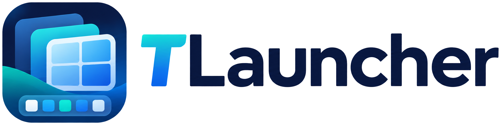
  </picture>
</p>

<p align="center"><strong>Your Windows. Your Workspace.</strong></p>

<p align="center">
  <a href="https://github.com/tuanngbc/TLauncher/releases/latest"></a>
  <a href="https://github.com/tuanngbc/TLauncher/releases/latest"></a>
  <a href="README-rust.md"></a>
  <a href="LICENSE"></a>
  <a href="https://github.com/tuanngbc/TLauncher/releases"></a>
  <a href="https://github.com/tuanngbc/TLauncher/stargazers"></a>
</p>

[Tiếng Việt](README.md) · [English](README.en.md) · **简体中文**

# 把 Windows 变成属于你的工作空间

也许你喜欢 Windows 的使用习惯，却希望桌面更清爽一些，常用应用更容易找到，多个窗口之间的切换也更从容。**TLauncher** 正是为这样的需求而设计的。

TLauncher 是一款面向 Windows 11 的免费开源桌面工具，主要使用 Rust 原生开发。它将受 macOS 启发的 Dock、台前调度（Stage Manager）、Spotlight、交互式动态壁纸和日常小工具融为一体，同时保留熟悉的 Windows 使用环境。你可以使用整套功能，也可以只开启自己喜欢的部分。

**[⬇ 下载 TLauncher（Windows 11 x64）](https://github.com/tuanngbc/TLauncher/releases/latest)** · [v1.0.2 更新内容](docs/releases/v1.0.2.zh-CN.md) · [问题反馈与建议](https://github.com/tuanngbc/TLauncher/issues)

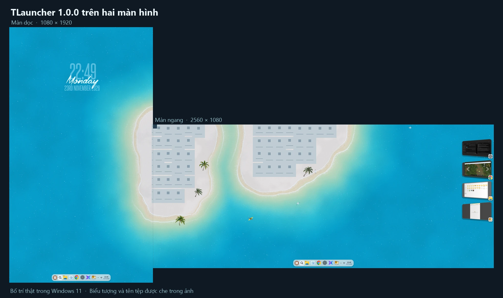

*早期版本的 Windows 11 实际桌面截图，横屏 2560×1080、竖屏 1080×1920，个人桌面信息已遮挡。*

## 探索 TLauncher

| 高效工作 | 个性化桌面 | 日常工具 |
| --- | --- | --- |
| Spotlight、应用库、Dock、台前调度、开始菜单 | 16 款动态主题、天气、时间光照、多显示器、双时钟 | 控制中心、月历、系统指标、截图编辑、MP4 录屏 |

[Spotlight](#spotlight快速搜索轻松启动) · [更多功能](#dock常用应用触手可及) · [快速上手](#几步即可上手) · [快捷键](#常用快捷键) · [常见问题](#常见问题)

<!-- product-guide:start -->
## Spotlight：快速搜索，轻松启动

**v1.0.2** 的核心更新是统一的 Spotlight。不必再翻找层层菜单，用键盘即可查找应用，也可以打开全屏应用库，一览已经发现的应用程序。

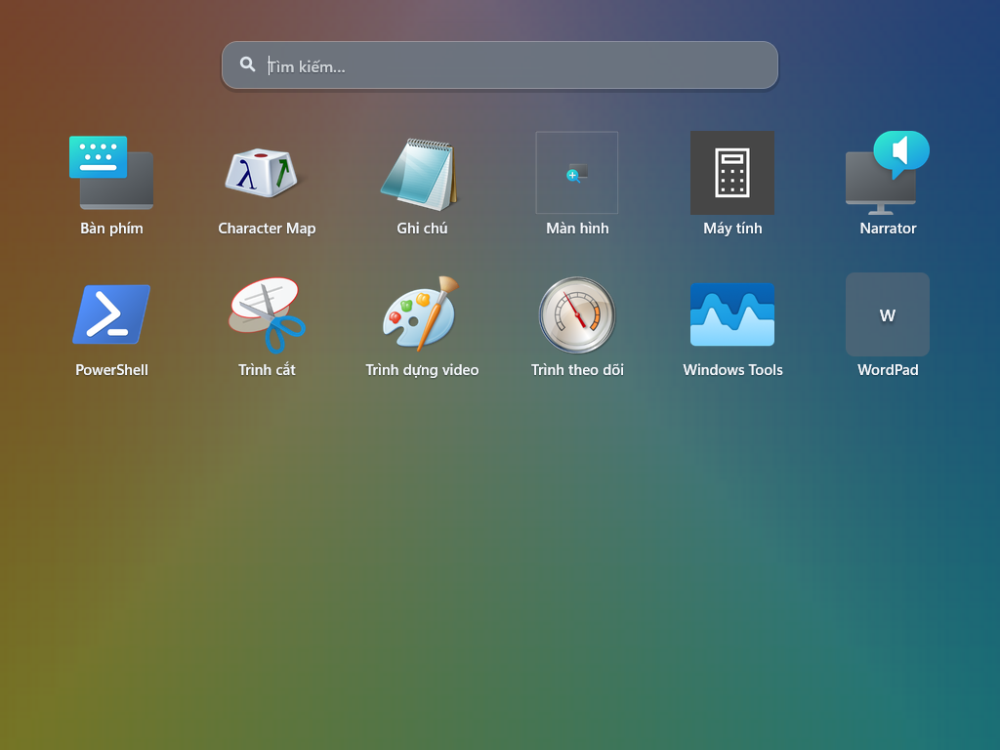

同一套搜索系统，两种使用方式：

- **紧凑模式（Compact）：** 按下 `Alt + Space`，输入应用名称、已索引的文件或系统工具，用方向键选择，按 Enter 打开。
- **全屏模式（Fullscreen）：** 点击 Dock 上的放大镜，在该显示器上打开应用库。滚动鼠标或使用键盘翻页，点击应用启动，点击空白处或按 Esc 关闭。

按 **F6** 可在两种模式之间切换，已输入的关键词不会丢失。在 **设置 → 快捷键与实用工具 → Unified Spotlight** 中，可以分别配置快捷键和 Dock 的打开模式，也可以让 Dock 跟随快捷键设置。

### 按自己的习惯整理应用

Spotlight 自动发现开始菜单和 Windows AppsFolder 中的应用，过滤不适合作为应用入口的快捷方式，并在能识别相同应用时去重。你还可以进一步整理应用库。

| 深色主题中的应用文件夹 | 编辑应用布局 |
| --- | --- |
| 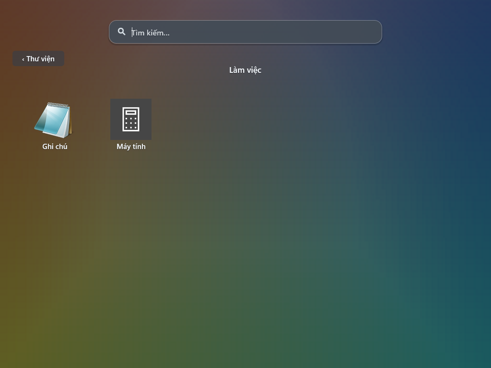 | 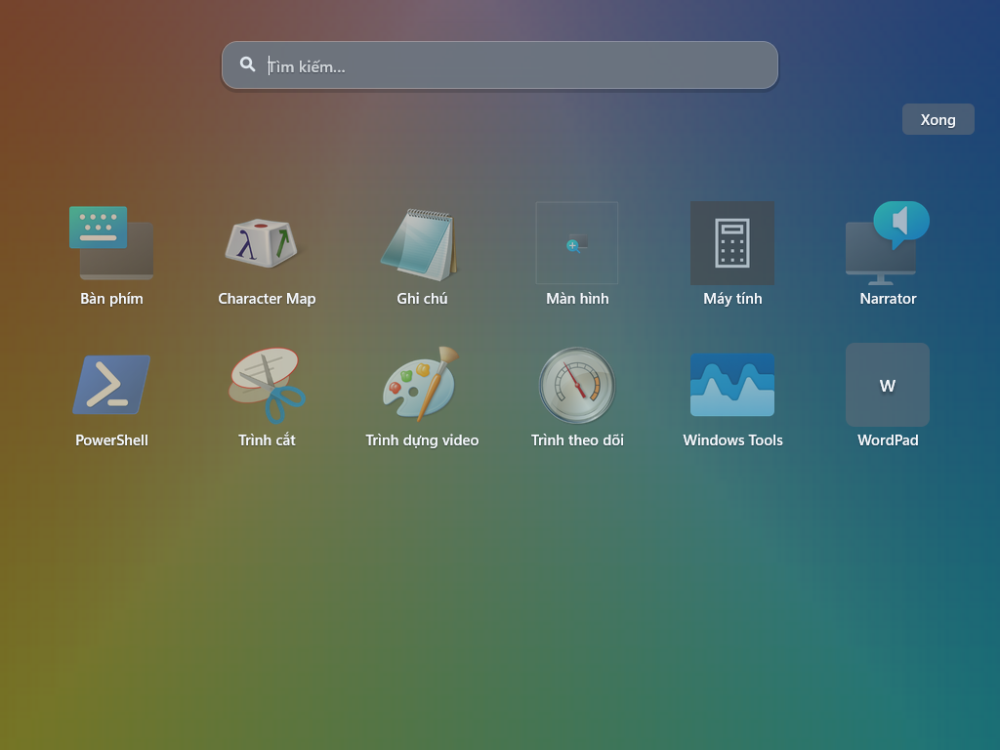 |

右键应用，可执行重命名、更换图标、收藏、固定到 Dock 或隐藏等操作。通过应用库管理菜单添加 `.exe` 或 `.lnk`，包括便携软件；进入布局编辑模式后可调整顺序，并将应用拖入文件夹。在设置中的 **已隐藏项目** 恢复应用。隐藏或移除手动添加的条目不会卸载或删除原程序。

### 磨砂玻璃、清晰文字与可调节动效

Spotlight 1.0.2 提供浅色和深色外观、统一的圆角搜索框、带柔和阴影的象牙白文字，以及减少重复加载的持久图标缓存。在兼容环境下使用 Windows 原生合成效果实现磨砂玻璃，不兼容时提供备用材质。

| 浅色搜索框 | 深色搜索框 |
| --- | --- |
|  |  |

在 **设置 → 动画效果** 中，可将速度调节为 **0.25× 至 2×**，新配置默认 **0.70×**。统一速度适用于 Spotlight、Dock、开始菜单、菜单和工具面板所支持的过渡动画。也可关闭动画，或让 TLauncher 遵循 Windows 的减少动态效果偏好。

*上述 v1.0.2 Spotlight 图片来自原生 Windows 界面的实际测试，使用示例数据，并非设计稿。应用库截图采用测试背景，不代表实时桌面模糊效果。[图片来源](docs/images/showcase/v1.0.2/README.md)。*

## Dock：常用应用触手可及

将最常使用的程序集中在 Dock 上。支持固定应用、快捷方式或带参数的自定义命令；点击图标启动应用或切换窗口。鼠标悬停时图标放大，Dock 随内容调整大小，并可自动隐藏，为最大化窗口腾出空间。

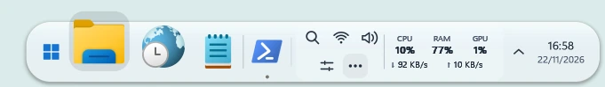

在 **设置 → Dock 与台前调度** 中选择显示器、停靠边缘、图标大小、间距、放大程度、玻璃材质及明暗外观。Dock 可浮动显示、预留工作区，或在窗口最大化时自动隐藏。每块屏幕可采用独立布局。

## 台前调度：在多个窗口之间从容切换

同时打开多个程序时，台前调度会在屏幕边缘用卡片显示窗口预览。点击卡片切换窗口，使用箭头浏览分组中的其他成员。支持平面或透视卡片，可调整大小、每页卡片数量及位置。

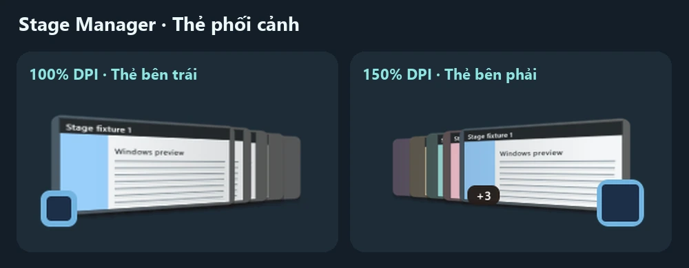

受 Windows 保护的内容可能无法提供预览。v1.0.2 保留 Windows 标准窗口最小化和恢复效果，暂不包含 Stage Peek 或 Genie。

## 开始菜单：熟悉的应用入口

开始菜单集合固定、最近使用及常用应用，并提供账户和电源选项。打开后搜索框可直接接收键盘输入。在 Dock 模式下，单独按 Windows 键可打开 TLauncher 的开始菜单；如果更喜欢系统原版开始菜单和任务栏，选择 **Windows 兼容模式** 即可。

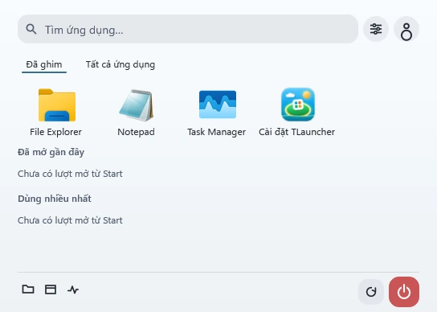

## 动态壁纸：让桌面更有生气

内置 **16 款交互式主题**，包括海滩、马尔代夫、水族箱、草原、体育场、海洋和夏日露台等。根据场景不同，点击桌面空白处可以激起水波、吸引鱼群或生成云朵；桌面图标仍可正常使用。

| 海滩 | 马尔代夫 | 草原 |
| --- | --- | --- |
|  |  |  |

打开 **设置 → 壁纸** 选择主题并调整参数。部分场景围绕桌面图标区域设计。更喜欢静态桌面？可以单独关闭动态壁纸，继续使用 Dock、台前调度和 Spotlight。

### 随时间变化的天气、光照与阴影

让场景随着一天中的光照变化，或模拟晴天、云、雨、雪及风。在 **设置 → 天气与光照** 中选择手动天气、离线模拟，或搜索城市/邮政编码，使用 Open-Meteo 的天气数据。支持日照阴影的场景会根据太阳位置改变阴影方向和长度。天气与时间光照可以分别开启或关闭。


## 多显示器：更大的空间，更自由的布局

无论使用单屏、双横屏还是横竖屏组合，都可以在 **设置 → 显示器** 中选择壁纸布局：

| 模式 | 使用方式 |
| --- | --- |
| 同步 | 所有显示器使用同一主题 |
| 独立 | 每块显示器选择自己的主题 |
| 全景 | 按 Windows 中的实际屏幕位置延展场景 |

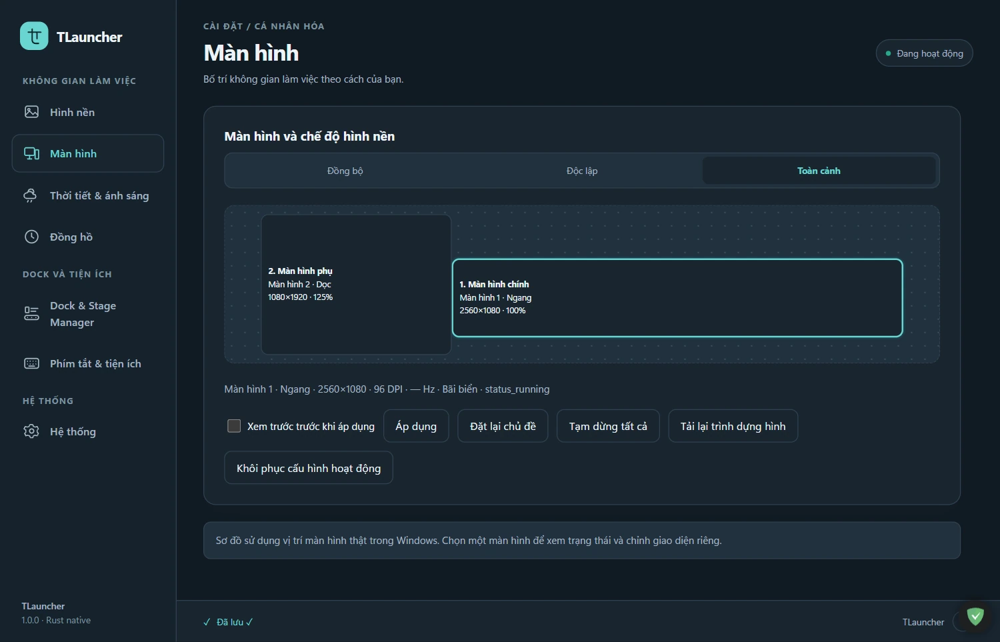

支持暂停单块屏幕的壁纸，分别设置 Dock 和台前调度，包括不同 DPI 缩放的布局。

### 双桌面时钟

在窗口下方添加显示时间、星期和日期的时钟。在 **设置 → 时钟** 中，可开启第二个时钟，选择显示器、大小、透明度及显示行。解锁后拖到喜欢的位置，再锁定即可让鼠标点击穿透。

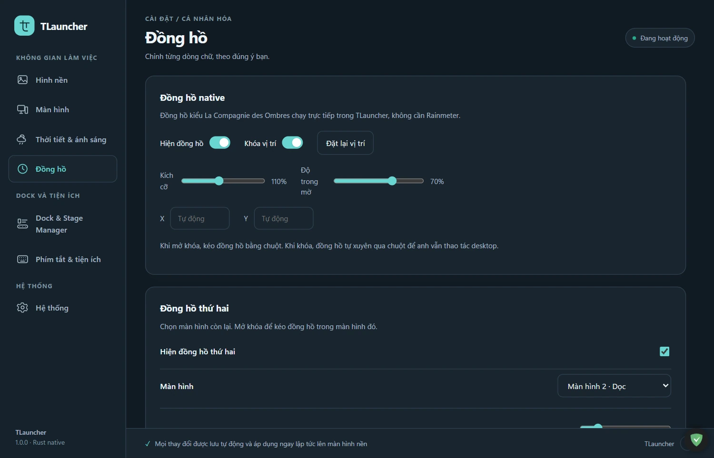

## 日常小工具，随手可用

**控制中心：** 点击 Dock 上的箭头调整音量，访问网络和蓝牙相关工具。点击日期时间打开月历；按需开启 CPU、GPU、内存、网络及状态指标。

| 月历 | Dock 系统指标 |
| --- | --- |
| 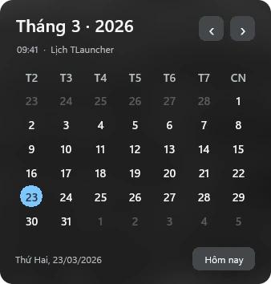 | 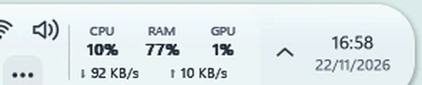 |

**截图与编辑：** 按 `Ctrl + Shift + S` 拖选区域，或按 Space 选择鼠标所在的整块屏幕。支持裁剪、箭头、文字、步骤编号、像素化及遮盖敏感信息，之后复制到剪贴板或保存 PNG/JPG。

**录屏：** 按 `Ctrl + Shift + R` 选择区域，再按一次停止。支持 30 或 60 FPS 的 MP4/H.264，可选系统播放声音；按 `Ctrl + Shift + P` 暂停或继续。当前不包含麦克风、摄像头或专用游戏录制模式。

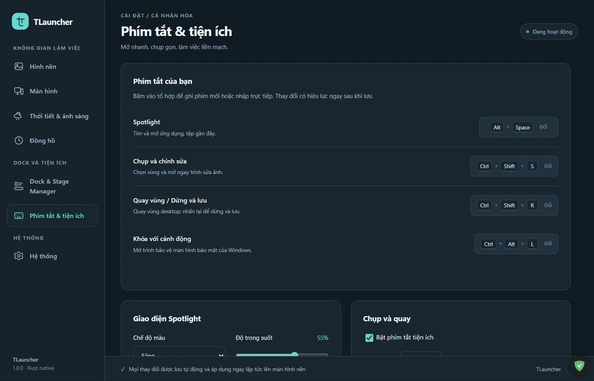

## 按自己的喜好设置桌面

集成设置提供越南语、英语和简体中文，可独立开启壁纸、Dock 和台前调度，并调整显示器、主题、快捷键、动画和开机启动。部分原生界面的文字可能仍使用其他语言。Explorer 会继续运行；选择 **Windows 兼容模式** 即可使用原生任务栏及系统托盘，包括第三方应用的托盘图标。

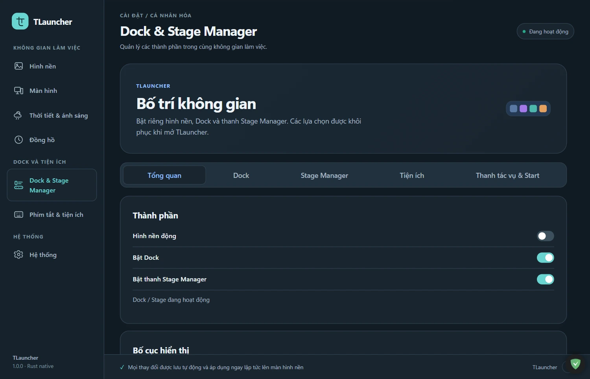

*以上非 Spotlight 功能的图片来自较早版本或原生测试，1.0.2 的布局和界面文字可能略有不同。*
<!-- product-guide:end -->

## 几步即可上手

**运行要求：** Windows 11 x64；动态壁纸需要支持 OpenGL 3.3 的显卡驱动；完整设置界面需要 Microsoft Edge WebView2 Runtime。普通用户无需安装 Rust 或开发工具。

1. 从 [GitHub Releases](https://github.com/tuanngbc/TLauncher/releases/latest) 的 Assets 下载 Windows x64 压缩包，而不是 Source code。v1.0.2 文件名为 `TLauncher-1.0.2-win-x64.zip`，可使用 [SHA-256 校验文件](https://github.com/tuanngbc/TLauncher/releases/download/v1.0.2/TLauncher-1.0.2-win-x64.zip.sha256) 核对。
2. 将**整个压缩包**解压到准备长期使用的文件夹。保留 EXE 旁的 `prototype/`、`assets/widget/` 和其他资源。
3. 运行 `TLauncher.exe`，从 Dock 或系统托盘打开设置，选择壁纸、开启需要的组件，再试试 Alt+Space。
4. 如希望登录 Windows 后自动运行，在 **设置 → 系统 → 随 Windows 启动** 中开启选项。TLauncher 通过任务计划程序为当前账户注册启动项，无需管理员权限。

### 推荐设置

| 项目 | 建议 |
| --- | --- |
| Windows 透明效果 | **设置 → 个性化 → 颜色 → 透明效果：开启** |
| Windows 动画效果 | 如喜欢动效，在 **辅助功能 → 视觉效果** 中开启动画 |
| TLauncher 动画 | 开启，从 **0.70×** 开始，按个人喜好调整 |
| Spotlight | Alt+Space 打开紧凑模式，Dock 打开全屏模式，或自定义 |
| 主题 | 浅色、深色或跟随系统 |
| 窗口过渡 | 保留 Windows 默认效果 |

这些是体验建议，而非软件运行的硬性条件。可按 Win+R 输入 `ms-settings:easeofaccess-visualeffects` 快速打开视觉效果页面。若曾为测试 Scale 关闭系统最小化动画，可按 Win+R 输入 `SystemPropertiesPerformance.exe`，在视觉效果中恢复“在最大化和最小化时动态显示窗口”。

### 升级与回退

退出旧版，备份安装文件夹及 `%USERPROFILE%\.deskland-rs`，再完整解压新版本。保留配置以继续使用壁纸、固定应用、屏幕布局及快捷键。若 EXE 路径有变化，关闭后重新开启自动启动，以更新任务计划。回退到 1.0.1 时，先关闭新版自动启动并退出，再恢复旧版程序和合适的配置备份，按需重新注册启动。旧版可能无法识别新版应用库数据。

## 常用快捷键

| 默认快捷键 | 操作 |
| --- | --- |
| Alt + Space | 打开或关闭 Spotlight |
| F6 | Spotlight 打开时切换紧凑/全屏模式 |
| Esc | 退出文件夹或关闭 Spotlight |
| ↑ ↓ ← → / Enter | 选择并打开结果 |
| Ctrl + Shift + S | 截图 |
| Ctrl + Shift + R | 开始或停止录屏 |
| Ctrl + Shift + P | 暂停或继续录屏 |
| Ctrl + Alt + L | 锁定 Windows |
| Ctrl + Alt + Shift + F12 | 恢复当前会话的 Windows 任务栏 |

在 **快捷键与实用工具** 中自定义 Spotlight、截图、录屏和锁屏快捷键。

## 为长期运行的桌面而设计

TLauncher 使用 Rust 和 Win32 集成桌面，使用 OpenGL 3.3/WGL 渲染壁纸，在兼容环境下使用 Direct3D 11/DirectComposition，GDI 作为备用路径。设置界面按需使用 WebView2；兼容的捕获与录屏路径使用 Windows Graphics Capture 和 Media Foundation。

动态壁纸通常以约 30 FPS 运行，交互时可短时提高帧率；壁纸被遮挡、会话锁定或显示器关闭时减少或暂停渲染工作。v1.0.2 注重图标复用、有界预览缓存、共享图形工厂和关闭 Spotlight 后释放表面资源，让桌面保持响应，同时避免不必要的图形工作。

目前尚无完整应用基准测试能证明所有配置均达到 100–150 MiB 内存、3% GPU 或 1% CPU。[资源优化报告](docs/TLAUNCHER_RESOURCE_OPTIMIZATION_REPORT.md) 记录了测量结果与范围，实际占用取决于场景、显示器、驱动和正在使用的功能。

## 常见问题

**为什么没有磨砂玻璃效果？** 检查 Windows 透明效果。原生玻璃依赖系统合成器和驱动，不兼容时可使用一次性模糊背景或纯色备用材质，并尊重高对比度设置。

**为什么 Spotlight 找不到某个应用？** 部分非应用快捷方式会被过滤。可以手动添加 EXE/LNK 或检查已隐藏项目。

**为什么只显示基础设置界面？** 检查 WebView2 Runtime 以及 EXE 旁的 `prototype/` 文件夹。

**可以恢复原生 Windows 桌面吗？** 选择 Windows 兼容模式，或按 Ctrl+Alt+Shift+F12 恢复当前会话的任务栏。在 TLauncher 菜单中选择退出即可关闭程序。

**为什么启动应用列表中看不到 TLauncher？** 自 1.0.1 起使用任务计划程序注册自动启动，请使用 TLauncher 设置中的开关。

**支持 Scale 或 Genie 吗？** 当前不支持。Scale 未通过实际机器验收，已在公开版本中隐藏；Windows 正常处理最小化和恢复。玻璃质量、输入法表现和部分窗口预览能力仍与系统环境有关。

## 隐私

使用实时天气时，所选地点的搜索词和坐标会发送给 Open-Meteo；该功能不会自动获取设备位置。也可以使用离线模拟。截图和录像默认保存在本地的 `Pictures/TLauncher` 与 `Videos/TLauncher` 中。Windows 可能限制对受保护内容的捕获。

## 开发者与社区

TLauncher 是独立开源项目，与同名 Minecraft 启动器无关，也不是 Apple 或 Microsoft 的官方产品。

如需从源码构建，请在 Windows 上安装 Rust stable、C++ MSVC 工具及 Windows SDK：

```powershell
cargo test --release
cargo build --release
```

参阅 [Rust 使用指南](README-rust.md)、[技术文档](docs/README.md)、[开发约定](AGENTS.md) 和 [更新日志](CHANGELOG.md)。发行包内含 `VERSION.txt` 和 `BUILD-COMMIT.txt`。

有建议或发现问题？欢迎 [提交 Issue](https://github.com/tuanngbc/TLauncher/issues)，附上应用版本、Windows 版本、显示器布局及复现步骤。请先遮挡截图和日志中的个人信息。

## 致谢

TLauncher 由 [tuanngbc](https://github.com/tuanngbc) 开发与维护，基于 [BLEZZ0102/Deskland](https://github.com/BLEZZ0102/Deskland) 的动态壁纸基础，以及 [nhhoang188/Deskland-VN](https://github.com/nhhoang188/Deskland-VN) 的主题和越南语本地化成果，并扩展了 Rust 原生渲染、多显示器、窗口管理、应用启动器和桌面实用工具。

感谢所有为项目奠定基础的作者和开源社区。参阅 [NOTICE](NOTICE)、[Deskland-VN NOTICE](third_party/deskland-vn/NOTICE) 和 [时钟设计致谢](assets/widget/NOTICE.txt)。

**许可证：** [GNU GPL-3.0](LICENSE) · [第三方声明](THIRD_PARTY_NOTICES.md) · [商标](TRADEMARKS.md) · [品牌指南](assets/branding/BRAND.md)。
